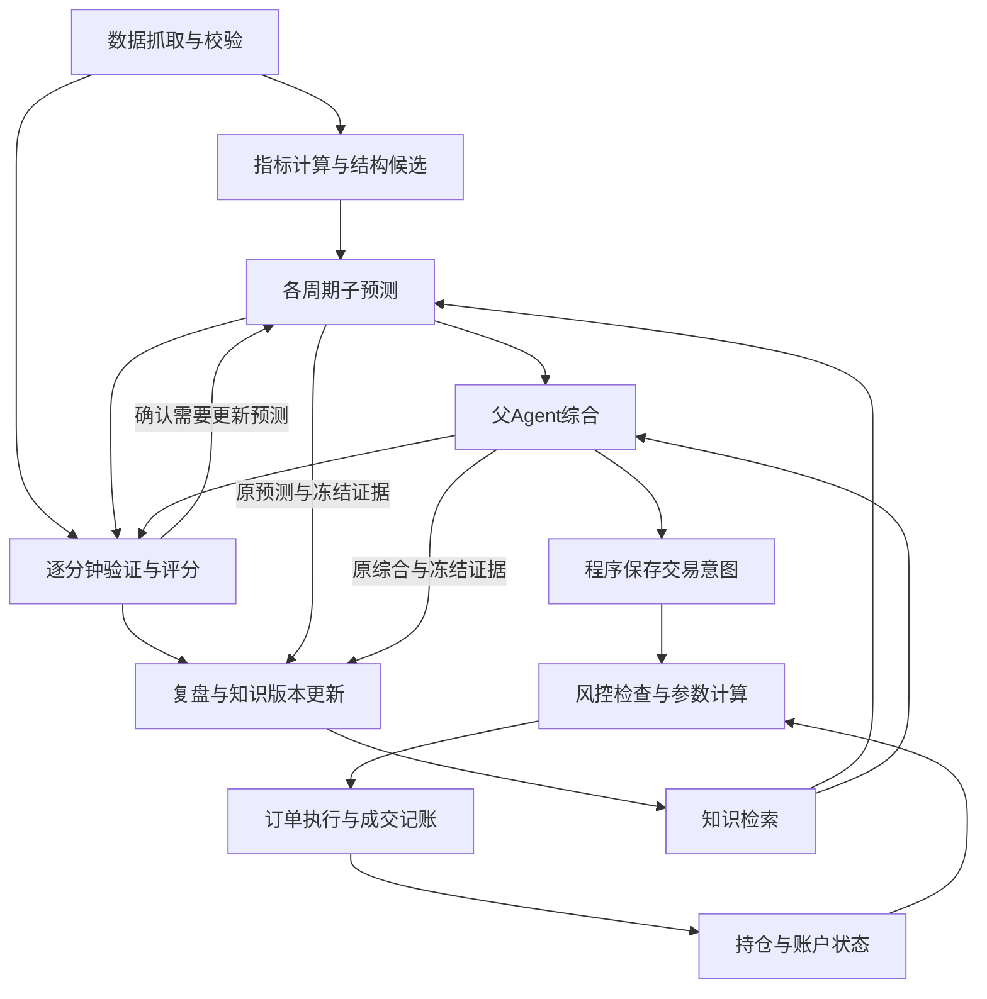

# Open Trade

BTC、ETH 的多周期结构与趋势预测驱动交易。

**系统有一条从行情到交易的主线，一条验证与学习的反馈链，以及交互、调度、存储等公共支撑。**
下面按当前源码说明各模块如何连接；源码中的功能需要独立配置与验收后才能用于实际运行。

## 业务主线与反馈链



图中的风控通过后才进入执行；HOLD 不生成交易订单。预测是否有效由程序持续验证，
复盘利用历史预测、当时证据和评分改善后续分析。下面展开这六个业务模块。

## 六个业务模块内部如何连接

### 1. 数据抓取：外部数据 → 可供计算的行情证据

- **行情读取**：获取已收盘K线、当前未收盘快照、合约信息，以及OI、资金费率、多空比等观测。
  固定币种篮子的K线交给市场宽度计算；读取适配器与订单发送适配器分开。
- **逐笔成交采集**：历史逐笔 → 按分钟区分主动买量/卖量 → 与同分钟K线量校验 → 保存分钟事实。
  CVD 使用这些分钟事实。断点续抓和历史补抓属于采集模块，不由预测Agent执行。
- **强平样本采集**：单独的WebSocket采样器保存公开样本及覆盖范围，供辅助指标读取。
- **证据入库与冻结**：记录合约、时间、来源版本和质量；预测准备程序选取本次允许使用的数据。
  缺失数据保留缺失标记，不补造买卖量。

### 2. 指标计算与结构分析：行情证据 → 数值、候选结构 → 预测输入

- **指标公式**：收益率、ATR、RSI等技术指标，以及CVD、OI变化、资金费率、市场宽度等外部指标。
  分钟买卖量先按对应周期汇总，再参与该周期的CVD计算；覆盖不足会影响质量标记。
- **结构几何计算**：关键点 → 箱体、三角、W底等候选 → 边界、阶段、容差与证据。
  程序生成候选，预测Agent选择和解释；形态名称不会直接生成订单。
- **模型输入组织**：每周期后台使用80根已收盘K线计算指标；临时指标使用80根已收盘K线＋1根未收盘快照。
  子模型收到30根已收盘K线明细＋同一根未收盘快照，以及计算结果。输入按本次时点固定保存。

### 3. 预测与复盘：预测、验证、知识更新和期限学习

每币种维护1h、4h、6h、12h四个子周期预测和一个父综合。子预测说明该周期的结构、条件情景、
目标和期限；父综合判断各周期关系并选择交易动作。验证评分、模型复盘和程序期限学习分别负责后续不同工作。

| 内部功能 | 输入、处理与交接 |
| --- | --- |
| 周期预测与父综合 | 调度器确认哪些周期需要更新 → 同币种一轮分析并行更新所需子周期、复用其余有效结果 → 父Agent统一综合 → 程序校验并保存预测与交易意图。父综合读取有效子报告，必要时回看其冻结证据，不另抓一套父行情 |
| 逐分钟验证与评分 | 后续分钟行情＋已发布预测 → 程序判断触发、目标、失效、期限及数据质量 → 追加评分修订；确认需要重分析时通知调度器更新相应周期。这里不调用模型逐分钟重算全部预测 |
| 模型复盘与知识更新 | 历史预测＋原输入/可追溯证据＋评分，另加复盘时点行情 → 复盘Agent提出知识修订 → 程序验证并追加知识版本 → 更新检索索引，供未来预测使用 |
| 程序验证预测期限 | 预测样本 → 配对回放 → 后续影子验证 → 按规则生效或回滚期限版本。这是确定性学习程序，与模型提出知识建议分别运行 |

知识按 summary（摘要）、content（正文与案例）、procedure（操作步骤）组织。
后续知识与期限版本不改写已发布预测、原输入或历史评分。

### 4. 风控：交易意图＋行情与账户状态 → 允许/拒绝及交易参数

- **执行资格检查**：意图是否仍有效、当前父结论是否可用、持仓身份是否匹配、账户是否熔断或暂停。
- **风险参数与额度检查**：沿用原有趋势/区间参数，计算仓位、杠杆、止损止盈并检查账户限制。
  新闻/社媒风险按原配置开关，在准备订单时作为额外风险输入；它不替代父Agent决定方向。
- **持仓风险监测**：成交后的账户与持仓持续接受止损止盈、移动/区间退出及结构失效检查，
  必要时产生绑定该持仓的平仓意图。预测单纯到期继续现有退出监测，不直接平仓。

模型提出开多、开空、观望或平仓意图；最终参数与执行许可由程序决定。
模型不能调用订单接口或提高风险上限。

### 5. 订单执行与记账：获准意图 → 订单状态 → 已确认成交 → 账户与持仓

- **订单流程**：保存准备/发送状态 → 调用传输适配器 → 查询成交、部分成交、撤销或结果未知。
  发送结果不明时核对原订单，不盲目重新下单。
- **传输适配器**：PaperTransport 生成可重现的模拟成交；代码另保留OKX适配器。
  公开示例保持暂停并关闭执行；使用实盘适配器需要独立配置、授权和验收。
- **成交记账**：只把确认的增量成交应用到账户和持仓，防止重复记账；更新后的状态回到风控监测。
  订单状态和需要通知的执行事件进入通知队列。

### 6. 网关、对话与通知：两条路径复用既有Hermes接入

**你主动提问时：** TG → Hermes Gateway → 主控Hermes → trading-bridge → runtime控制API。
主控查询预测、持仓和状态，或申请解释/复盘。它与上文负责预测的父Agent是不同角色。

**程序主动通知时：** 需要通知的事件 → outbox队列 → Notifier/HermesSender →
按用途选择主控或预测Profile → 对应TG。它复用既有接入，不另建网关，也不要求模型自行发消息。
系统启动、系统健康检查和账户/执行通知走主控；配置独立预测通知目标后，预测Bot只接收父综合结果（含HOLD）和错误告警。
每次父综合发一条结论在前的摘要；子周期结果、目标达成、到期、失效、歧义及分析恢复成功仅留后台记录。
主控主动申请的解释/复盘仍回复主控。通知结果未知时保留记录并停止自动重发。

## 公共支撑与代码所在位置

| 公共支撑 | 负责什么、供谁使用 |
| --- | --- |
| runtime运行编排与jobs任务管理 | 组装上述服务；调度、任务执行、通知、恢复四个循环驱动工作。任务领取、授权、租约、实例归属和超时保护供各业务模块共用；“任务执行”包含预测/复盘等工作，并非只指下单 |
| 模型运行与隔离 | AgentRunner调用独立预测Hermes；研究插件提供任务数据、知识检索和正式提交工具；Cube承接受限终端。业务规则在预测/复盘服务，模型进程与资源生命周期在运行支撑层 |
| 存储、检索与运维 | PostgreSQL保存行情、预测、评分、知识、意图、成交和审计事实；SQLite/FTS5仅用于可重建的知识检索。迁移、最小权限、备份和健康检查围绕这套事实库工作 |

业务模块说明“系统做什么”，下面三个代码包说明“实现放在哪里”。同一业务模块可能跨包调用：

| 目录 | 在当前流程中的位置 |
| --- | --- |
| `trading-agent/` | 唯一runtime，负责上述业务服务的组织、任务/API、事实保存、模型调用与通知；入口为 `ta --config <配置文件> serve` |
| `packages/trading-core/` | runtime调用的共享风控参数、风险评估、记账与退出规则，以及交易查询/发送和社媒风险组件；没有第二个业务调度器 |
| `packages/trading-quant/` | 指标与结构几何公式，由runtime的行情/特征适配层调用；不负责模型、账户或订单 |
| `config/` | 通用暂停示例；不包含操作者现用参数、账户或币池；字段名 `legacy_config_dir` 用于指向这组配置 |
| `archive/` | 历史源码和资料，不安装、不部署、不作为当前运行入口 |

当前有些职责仍集中在同一个类中：`PredictionService`同时涉及冻结、发布、验证和意图创建；
`ExecutionService`串联资格检查、风控调用、订单状态和记账；`Runtime`负责组装及任务分派。
这份地图明确现有连接，不代表这些职责已被拆成独立组件。

<details>
<summary>需要改代码时，从哪里进入：实现与对应测试</summary>

| 要改的功能 | 主要实现入口 | 对应测试入口 |
| --- | --- | --- |
| 行情读取、只读权限和外部观测 | [OKXClient](trading-agent/src/trading_agent/market/okx.py)、[只读适配器](trading-agent/src/trading_agent/market/authenticated.py)、[观测解析](trading-agent/src/trading_agent/market/observations.py) | [行情客户端](trading-agent/tests/unit/test_prediction_market_client.py)、[只读权限](trading-agent/tests/unit/test_authenticated_market.py) |
| 逐笔分钟聚合、补抓与断点 | [TradeMinuteCollector](trading-agent/src/trading_agent/market/trade_collector.py)、[逐笔校验](trading-agent/src/trading_agent/market/trades.py)、[断点保存](trading-agent/src/trading_agent/storage/trade_checkpoints.py)、[周期聚合窗口](trading-agent/src/trading_agent/storage/trades.py) | [分钟聚合](trading-agent/tests/integration/test_trade_minutes.py)、[断点恢复](trading-agent/tests/integration/test_trade_checkpoints.py) |
| 强平样本与固定篮子 | [LiquidationSampler](trading-agent/src/trading_agent/market/liquidations.py)、[篮子行情](trading-agent/src/trading_agent/market/breadth.py) | [强平采样](trading-agent/tests/integration/test_liquidation_sampler.py)、[市场宽度](trading-agent/tests/unit/test_breadth.py) |
| 指标、结构及30＋1模型输入 | [指标公式](packages/trading-quant/src/trading_quant/features.py)、[结构公式](packages/trading-quant/src/trading_quant/structures.py)、[冻结输入](trading-agent/src/trading_agent/prediction/service.py)、[模型序列化](trading-agent/src/trading_agent/prediction/submissions.py) | [共享量化](tests/test_shared_quantitative.py)、[未收盘快照](trading-agent/tests/integration/test_forming_candle_inputs.py)、[模型输入](trading-agent/tests/integration/test_model_candle_payload.py) |
| 周期更新、并行子分析和父综合 | [PredictionScheduler](trading-agent/src/trading_agent/prediction/scheduler.py)、[AnalysisRounds](trading-agent/src/trading_agent/prediction/rounds.py)、[父输入组织](trading-agent/src/trading_agent/prediction/synthesis.py)、[结构提示词](trading-agent/prompts/structural) | [分析轮次](trading-agent/tests/integration/test_analysis_rounds.py)、[父综合](trading-agent/tests/integration/test_parent_synthesis.py) |
| 预测验证、评分与结构监测 | [行情与验证协调](trading-agent/src/trading_agent/prediction/market.py)、[评分规则](trading-agent/src/trading_agent/prediction/evaluation.py) | [预测验证](trading-agent/tests/unit/test_structure_predictions.py)、[行情验证流程](trading-agent/tests/integration/test_prediction_market.py) |
| 复盘案例、知识版本与检索 | [KnowledgeService](trading-agent/src/trading_agent/knowledge/service.py)、[案例输入](trading-agent/src/trading_agent/knowledge/review_inputs.py)、[KnowledgeIndex](trading-agent/src/trading_agent/knowledge/index.py) | [预测知识](trading-agent/tests/integration/test_prediction_knowledge.py)、[复盘行情](trading-agent/tests/integration/test_review_market_windows.py) |
| 期限回放、影子验证与回滚 | [HorizonService](trading-agent/src/trading_agent/prediction/horizons.py) | [期限流水线](trading-agent/tests/integration/test_horizon_pipeline.py) |
| 风控参数、社媒风险和执行资格 | [PredictionRiskAdapter](packages/trading-core/src/trading_core/prediction_adapter.py)、[RiskEngine](packages/trading-core/src/trading_core/risk/engine.py)、[参数公式](packages/trading-core/src/trading_core/strategy/risk_parameters.py)、[配置与社媒输入](trading-agent/src/trading_agent/execution/settings.py)、[ExecutionService](trading-agent/src/trading_agent/execution/service.py) | [预测风控](tests/test_prediction_risk_adapter.py)、[风险检查](tests/test_risk.py)、[预测执行](trading-agent/tests/integration/test_prediction_execution.py) |
| 订单状态、模拟传输和成交记账 | [ExecutionService](trading-agent/src/trading_agent/execution/service.py)、[传输适配器](trading-agent/src/trading_agent/execution/transport.py)、[AccountBook](packages/trading-core/src/trading_core/accounting.py) | [预测执行](trading-agent/tests/integration/test_prediction_execution.py)、[账户记账](tests/test_accounting_core.py)、[订单幂等](tests/test_order_idempotency.py) |
| TG主控查询与任务请求 | [trading-bridge](trading-agent/integrations/hermes/trading-bridge/__init__.py)、[控制API](trading-agent/src/trading_agent/api/controller.py)、[预测API](trading-agent/src/trading_agent/api/prediction.py) | [主控桥接](trading-agent/tests/integration/test_controller_bridge.py)、[预测API](trading-agent/tests/integration/test_prediction_api.py) |
| 主动通知、领取和发送确认 | [outbox与HermesSender](trading-agent/src/trading_agent/notifications/outbox.py)、[分析错误事件](trading-agent/src/trading_agent/prediction/rounds.py)、[执行事件](trading-agent/src/trading_agent/execution/service.py) | [通知队列](trading-agent/tests/integration/test_outbox.py)、[健康通知](trading-agent/tests/integration/test_doctor.py) |
| 运行编排、任务授权与模型隔离 | [组装入口](trading-agent/src/trading_agent/runtime/factory.py)、[Runtime](trading-agent/src/trading_agent/runtime/lifecycle.py)、[JobService](trading-agent/src/trading_agent/jobs/service.py)、[AgentRunner](trading-agent/src/trading_agent/runtime/agent_runner.py)、[Cube资源](trading-agent/src/trading_agent/runtime/sandboxes.py) | [结构运行](trading-agent/tests/integration/test_structural_runtime.py)、[任务授权](trading-agent/tests/integration/test_jobs.py)、[模型进程](trading-agent/tests/integration/test_prediction_runner.py)、[Cube生命周期](trading-agent/tests/integration/test_cube_lifecycle.py) |

这里只列维护入口，不把用例文件的存在当作本轮测试已通过。字段、风控与使用细节见
[实现与使用](docs/prediction-driven-implementation.md)；已开发、已部署和线上验收需分别查证。

</details>

## 可能存在的问题：逐笔成交与分钟聚合

OKX 已通过用户提供的客服回复确认主动成交统计接口存在数据问题，尚未完成修复验收。
本地已实现使用公开历史逐笔生成分钟买卖聚合，由确定性代码采集、检测及补抓，Agent 只读取
结果和质量标记。分钟聚合长期保存，原始逐笔默认压缩留存24小时。
[断点续抓修复](docs/cvd-checkpoint-repair-2026-11-04.md)增加分页恢复、预算暂停、轮转调度
与真实窗口覆盖状态；长窗口完整覆盖仍需独立验证，组件测试通过不等于源数据完整或方向正确。
实现、默认配置与验证边界见[分钟聚合交付说明](docs/trade-minute-aggregation-2026-11-03.md)。

- **可能漏数或重复计数**：分页边界、断线、重复交易 ID、迟到或源端修订都可能影响聚合。
  必须验证分页推进、按合约与交易 ID 去重，并对每个已结束分钟核对 K 线成交量。
- **总量正确但买卖方向错误仍可能存在**：买卖方向反转不会改变总成交量。总量校验不能证明
  CVD 正确；需要独立方向样例、分类复算与历史抽查。测试通过也不等于所有源数据永远正确。
- **历史补抓有边界**：当前官方历史逐笔接口提供最近三个月分页查询；本地明细过期后可在
  接口可用范围内补抓。K 线只有总量，不能反推买卖分配；超出回溯范围不保证能恢复明细。
- **冷启动和预算不足**：完整 CVD 需要最近 20 个周期的连续成交，12h 指标对应 10 天。
  分钟累计未覆盖、补抓未完成或校验失败必须明确缺失/部分覆盖，不能自动退回已知有问题的
  统计接口或按 K 线差额猜买卖方向。补抓的新版本不得改写旧预测冻结事实。

这些是开发阶段需持续验证的风险，不代表上述错误都已发生；已确认的源端问题与核查证据见
[CVD 差异调查](docs/cvd-volume-investigation-2026-10-31.md)。

## 可能存在的问题：预测评分的分钟内先后顺序

预测发布时已确定目标和失效条件。情景已经触发后，若同一根1分钟K线内既触达目标又满足
失效条件，当前程序统一记为 `AMBIGUOUS`，目标概率评分留空。“同一分钟”不表示精确同时发生。

- **触价失效与收盘确认失效需要区分**：触价失效时，分钟OHLC可能无法确定目标和失效的
  先后，应在确实无法判定时保留歧义。收盘确认失效则须按条件的确认时点判断，不能一律按
  同分钟歧义处理。例如，已触发的看涨情景目标105、失效条件为1分钟收盘跌破95；随后某分钟
  最高105、收盘94，目标触达先于收盘失效确认，这种情况不应仅因发生在同一分钟就判顺序未知。
- **现有测试预期也需要审查**：[评分逻辑](trading-agent/src/trading_agent/prediction/evaluation.py)
  当前未区分上述情况，[对应测试](trading-agent/tests/unit/test_structure_predictions.py)还将
  收盘跌破与目标同分钟出现预期为歧义。测试通过只证明实现符合当前预期，不能证明该预期
  符合业务规则；后续应分别验证触价、收盘确认、可判先后及不可判先后的情形。
- **发生频率与影响尚未统计**：较大的目标/失效线间距可能使这类情况较少出现，实际仍取决于
  百分比间距和当时波动，不能仅凭BTC/ETH的绝对币价认定只在黑天鹅时发生。应统计已发布
  预测中的出现次数和评分影响，再评估修复优先级；本节不代表正式库已确认存在误评分。

本次仅登记待核查的评分问题，尚未修复业务逻辑或测试，不改写已发布预测及历史评分。

## 安装和检查

需要 Python 3.11、uv；数据库集成使用独立 PostgreSQL 16，Hermes/Cube 接入另行配置。

```sh
cd trading-agent
uv sync --frozen --extra cube --group hermes-test
uv run --frozen --extra cube --group hermes-test ta --config config.yaml config check --json
uv run --frozen --extra cube --group hermes-test pytest -q tests/unit
```

`config check` 不启动服务；仓库示例配置不代表部署已经验收。
默认关闭执行。原 `trade-agent cycle/daemon` 已退役，不再安装旧 CLI 或旧服务模板。
已有机器上的旧安装不会被本次代码清理自动卸载；切换前核对旧服务已停止。
正式迁移、角色身份、Hermes、Cube 隔离证明、模型和通知配置见
[部署说明](trading-agent/docs/deployment.md)。不得仅凭本地测试启动实盘。公开示例保持暂停，关闭执行、私有读取与通知；
Hermes、Cube和专用数据库须自行提供，示例配置检查可能明确报告配置未完成。

## 当前文档

- [主控 Gateway 与预测 Hermes 链路恢复](docs/controller-hermes-restore-2026-10-22.md)
- [旧测试与日志清理、当前验证](docs/obsolete-research-cleanup-2026-10-22.md)
- [项目结构、迁移与回滚](docs/runtime-core-consolidation-2026-10-22.md)
- [预测驱动交易：实现与使用](docs/prediction-driven-implementation.md)
- [需求规格](docs/prediction-driven-trading-goal.md)、[技术决策](docs/prediction-driven-decisions.md)、[验证边界](docs/prediction-driven-validation.md)
- [只读行情与后续工作](docs/readonly-data-and-next-steps-2026-10-22.md)
- [本机模拟数据库与身份](docs/local-paper-database-and-identity-2026-10-22.md)
- [历史资料索引](archive/README.md)

本机完整模型预测/模拟交易的验收状态以具体交付记录为准；行情、数据库、组件测试和
真实模型效果分别报告。历史文档中的实盘、策略自动改代码或旧启动命令不构成当前操作授权。

共享交易核心的回归在根目录使用独立开发环境：

```sh
cd ..  # 从trading-agent返回仓库根目录
uv sync --frozen --python 3.11 --extra dev
uv run --frozen --extra dev pytest -q
```

旧研究和旧交易入口测试已移除；仍适用的风控、执行、记账与量化检查直接测试共享库。
开发和生产依赖均不再包含 pandas。

## 公开范围与更多说明

本仓库保留当前框架、完整需求/设计/使用文档、测试样例目录和退役源码参考。
个人账户、真实预测/交易/复盘原文、凭据和部署证据留在仓库外；历史文档为脱敏副本，不能照搬为启动授权。

- [全部当前测试样例](docs/test-case-catalog-2026-11-04.md)
- [架构概览](docs/architecture.md)、[独立部署准备](docs/deployment.md)、[测试方法](docs/testing.md)
- [已知限制](docs/limitations.md)、[公开范围与逐项处理](docs/publication-scope.md)
- [维护与自动同步](docs/automatic-sync.md)

## 许可证

本项目采用 [MIT License](LICENSE)，版权署名为 `2026 ChrisEvans2`。
