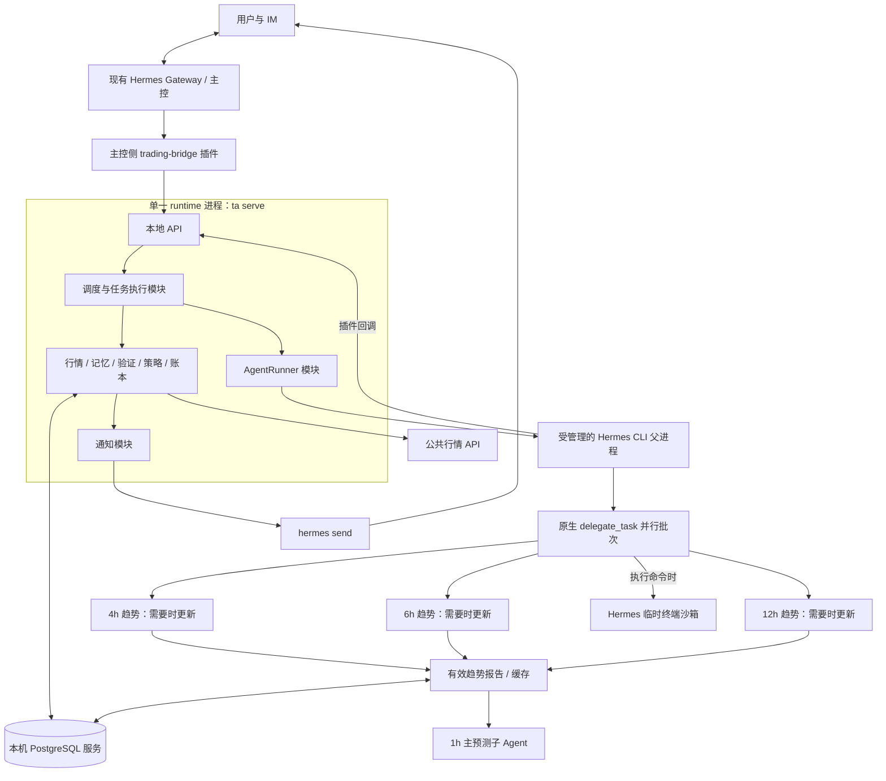

> 公开脱敏副本：安装路径、内部标识、个人链接及账户/原始业务记录已替换或隐去。历史状态和验证结果仅代表原文记录时点，不构成本仓库当前部署或收益验收。

> 2026-10-11更新：本文保留v1历史设计。当前结构预测/知识库以[新实现说明](../../../../../docs/prediction-driven-implementation.md)为准；旧策略代码迭代及memory-search/read活跃入口已退役，历史证据保留。

# 交易研究 Agent v1：实施设计

> 状态：核心预测、评分、复盘与运维已有代码和本地验证；合约账本、收益实验及在线验收未完成。2026-10-08新增旧项目兼容入口与指标实现归属调整，详见 [当前实施状态](../../implementation-status.md)。
> 2026-10-10：新增策略迭代经验的来源、summary/content、分类检索、冻结引用与更新边界，见第 6.5–6.8 节；已有本地实现，未做自动纠错或收益验证。
> 项目定位：基于 Hermes 的行情预测、市场验证与策略研究系统。
>
> Hermes 参考版本：本地提交 `71cb7d60f8`。本文件保留设计契约，具体落地状态以当前实施状态和各节注明的验证范围为准。
> 当前方案：每小时预测未来 1 小时；1h 原生子 Agent 使用 4h、6h、12h 趋势报告，长周期仅在新 K 线收盘后更新；统一 runtime 管理后端模块；通过 Hermes 终端后端插件接入可联网的 CubeSandbox；模拟合约支持多空。不按后端模块拆分容器部署。

## 0. 先读这一页

### 做什么

对 BTC 合约，每小时生成未来 1 小时的上涨／横盘／下跌概率。1h 子 Agent 负责主预测，4h、6h、12h 子 Agent 提供可复用的趋势背景。每周期后台保留 80 根已收盘 K 线计算指标，提供最近 30 根给对应 Agent。事前保存预测和证据，事后用真实市场数据评分；同时运行模拟合约交易、导入个人历史成交、生成复盘，并评估策略参数的候选版本。

Hermes 主控负责接收你的请求和查询结果。交易 Agent 使用独立 Profile，负责分析和解释。领域程序负责数据、计算、状态与权限。

### 已经定下来的选择

| 项目 | v1 决定 |
|---|---|
| 标的 | 仅 BTC 合约；逻辑标的保留 `BTCUSDT`，OKX 的真实 `instId`、合约类型与结算资产待锁定 |
| 行情来源 | OKX 对应合约的公共行情；具体合约标识和接口契约部署前锁定 |
| 数据粒度 | `1h` 主分析；`4h`、`6h`、`12h` 为趋势背景；每周期 80 根用于计算、最近 30 根用于 Agent 输入；`1m` 用于端点定价 |
| 子 Agent | 到期的长周期趋势任务先并行更新，再运行 1h 主分析；未到更新边界的趋势报告直接复用 |
| 预测 | 每小时一次，预测未来 1 小时的上涨／横盘／下跌概率 |
| 验证窗口 | 时段起点后第 5 分钟开始，持续 1 小时；长周期趋势报告不作为独立预测评分 |
| 交易范围 | 模拟合约，可开空与开多；不连接下单 API |
| 历史交易 | 保留 CSV 导入复盘能力；合约成交格式按开平仓与持仓方向重新定义 |
| 策略迭代 | 自动评估候选概率阈值；人工批准启用；支持回退 |
| 模型 | 部署时复制主控当前 provider/model 到交易 Profile 并锁定；主控后续切模型不影响它 |
| Agent 运行 | Hermes 独立 `trading` Profile；最多一个父任务；每次运行 1 个 1h 子任务及 0–3 个需更新的趋势子任务 |
| Hermes 核心 | 不修改；使用原生插件、CLI、子 Agent、终端沙箱与消息投递；Cron 只承担外部健康检查 |
| 记忆接入 | 原生偏好／会话记忆、PostgreSQL 预测案例、独立 SQLite 策略经验索引分别使用；策略迭代先看 summary，再按需读 content，见第 6.5–6.8 节 |
| 业务技术栈 | Python 3.11、FastAPI/Uvicorn、asyncio、Pydantic 2、SQLAlchemy 2、psycopg 3、Alembic、httpx |
| 数据库 | 核心业务使用本机 PostgreSQL 16；会话与策略经验各用独立 SQLite/FTS5；不加 Redis、Celery、向量数据库 |
| 部署 | `ta serve` 启动一个 runtime 进程，内含 API、调度、任务执行和全部领域模块；复用已有 Hermes 与 Gateway |
| 沙箱 | CubeSandbox，通过 Hermes 终端后端插件接入；每个父任务一个临时沙箱，本次实际运行的子 Agent 共享；支持公网访问 |
| 通知 | 沿用主控一个已配置的 IM 目标，通过 `hermes send` 投递 |
| 界面 | IM + CLI；v1 不开发网页 |

这些是工程范围选择，不代表已经验证了市场预测能力。第一版的成果是可审计的研究流程，预测效果另行测量。

本次已确认：保留 FTS5、改用可联网 CubeSandbox、模拟合约可多可空。合约类型、保证金模式、杠杆、费用与强平规则留待后续确定；原现货成交公式和费率不再适用。相关待定项明确标出，不能当成已经可运行的合约规格。

### 开发结束应该能演示什么

1. 在主控聊天中查询最新预测，能看到时间、概率、依据和验证状态。
2. 到期自动产生结果，原预测保留；可以追到当时的数据与策略版本。
3. 导入成交 CSV，得到费用、已实现收益和有证据的复盘。
4. 系统提出一个候选阈值，经过后续市场数据评估，人工批准后在下一时段生效。
5. 关闭并重启服务，已提交预测不丢失、到期验证继续、重复任务不重复落账。

阅读顺序：先看本节与第 2、4 节；开发时按第 15 节执行，表和接口按第 7、8 节实现。

## 1. 范围与职责

### 1.1 Hermes 负责的部分

- 大模型请求、工具调用循环、会话记录、CLI。
- 原生子 Agent 创建、并行执行、上下文与终端会话管理、结果返回。
- 主控聊天与 Gateway 接入。
- Cron 定时执行外部健康检查；业务任务调度由项目 runtime 负责。
- 交易 Agent 的隔离 Profile 和命令行执行环境。

### 1.2 本项目负责的部分

- 行情校验、不可变快照、预测登记与到期验证。
- 模拟成交和真实成交账本。
- 带时间边界的经验检索。
- 候选策略评估、人工审核、生效与回退。
- 领域任务恢复、幂等写入、通知记录和可验证指标。

### 1.3 v1 明确不做

- 实盘下单、多标的组合、高频响应。
- 独立的新闻、社交媒体和链上采集平台；允许按需 web 搜索与公开网页读取。
- 自主改写任意策略代码、自主修改验证标准、自主批准上线。
- 用历史 K 线重新调用 LLM 后，把生成结果冒充当时的预测。
- 多 Agent 辩论、分布式集群、自动训练预测模型。

这些内容不进入第一版实施任务，也不预留无实际使用者的抽象接口。

## 2. 运行结构与部署边界



### 2.1 单一 runtime 与模块划分

所有后端 Python 模块都在同一个 runtime 进程内，通过函数与对象调用协作，不互相调用 HTTP。FastAPI 只为 Hermes 插件和人工 CLI 提供本地入口，监听 `127.0.0.1:8765`。

| 模块 | runtime 管理的内容 | 部署方式 |
|---|---|---|
| `api` | 身份校验、请求校验、查询与提交 | 同进程 FastAPI 路由 |
| `scheduler` | 固定预测时段、到期验证、日报与实验计划 | 同进程 asyncio 后台任务 |
| `executor` | 队列领取、并发控制、重试与恢复 | 同进程 asyncio 后台任务，不启动独立 Worker 服务 |
| 领域模块 | 行情、特征、记忆、预测、复盘、策略、成交账本 | 同进程 Python 模块 |
| `agent_runner` | 启动、等待、超时终止 Hermes CLI，记录 attempt | runtime 内的进程管理模块，不设 Runner HTTP 服务 |
| `notifier` | outbox 领取、消息格式、调用 Hermes 发送 | 同进程 asyncio 后台任务 |
| `storage` | PostgreSQL 连接池、事务、repository | 同进程客户端；数据库使用本机标准服务 |

这里只有一个业务应用的启动和发布单元。PostgreSQL 是本机数据库服务，runtime 管理其连接而不把数据库服务器嵌入 Python。Hermes CLI 是为单次 Agent 任务启动的受管理子进程，不是额外部署的微服务。

Uvicorn 固定单 worker，禁止生产热重载。FastAPI lifespan 创建 runtime 和连接池，启动 scheduler/executor/notifier/recovery，退出时统一停止。I/O 使用异步客户端；会阻塞事件循环的计算或库调用送到 runtime 管理的有界线程池。

启动顺序：校验配置与迁移版本 → 取得数据库单实例锁 → 建立模块依赖 → 扫描未完成任务 → 启动后台循环 → readyz 成功。第二个 runtime 若拿不到单实例锁立即退出，避免误启动两套调度器。

关闭顺序：readyz 标记不可用 → 停止领取新任务 → 等待在途任务最多 20 秒 → 终止仍运行的 Agent 任务并使令牌失效 → 关闭连接池、释放实例锁。重新启动按持久任务状态恢复。

### 2.2 沙箱只负责 Agent 的执行边界

Hermes 的推理编排和受信任插件运行在宿主机的 CLI 子进程中；模型要求执行的终端命令通过 Hermes 后端接口进入 CubeSandbox。后端业务模块仍由同一个 runtime 管理。

当前参考仓库未内置 CubeSandbox 后端，但提供 `TerminalEnvironmentProvider` 插件接口。本项目新增 `trading-cube` 插件，注册名为 `cubesandbox` 的 provider；通过 CubeSandbox SDK/API 实现创建、命令执行、文件同步和清理，不修改 Hermes 核心。下列配置需要该插件安装后才有效：

```yaml
terminal:
  backend: cubesandbox
  container_persistent: false
  env_passthrough: []
```

provider 实现 `create_environment()`，返回实现 `execute()`、`cleanup()`、文件同步和后台进程所需 BaseEnvironment 契约的环境对象。声明远程、容器式路径与非持久会话隔离语义，按 attempt 记录 sandbox_id；Cube 服务认证列入 `strip_env_keys`，不传入模型命令的环境。命令结果与进程句柄按锁定 commit 的实际调用契约适配。插件适配和兼容测试属于新增工作，不能只修改 backend 字符串就认定已接通。

AgentRunner 通过适配器复制本任务输入到 `/workspace/input`，将其设为命令执行用户不可写；输出放 `/workspace/scratch`。模型命令显式以普通用户执行，输入文件及上级目录由该用户不可修改的身份持有；不能仅靠 chmod 后仍用 root 执行，需验证 sudo 和 guest 命令／文件管理服务不能绕过。本次实际运行的原生子 Agent 共享父任务沙箱与信任边界，临时文件按周期分目录；缓存趋势报告只作为只读输入。不同 attempt 使用不同沙箱。不挂载宿主机项目、主目录、交易 Profile、数据库、凭据或容器管理 socket。文件桥接及缓存同步仅允许授权的当前任务输入和限额输出，防止任意宿主机路径与符号链接逃逸。输入原件和 hash 保留在 runtime 一侧，沙箱副本不成为正式事实来源。

**解释／复盘沙箱允许联网；正式预测沙箱禁止出站。** CubeSandbox 提供 `allow_internet_access` 和出站策略；获准联网任务可访问公网，限制访问宿主机、业务数据库、管理接口和云元数据地址，包括敏感服务使用的公网 IP。正式任务设置 `allow_internet_access=False`，不配置出站 allow 例外。策略由受信任适配器设置，模型不能修改；核对 allow 优先于 deny 的行为，并关闭 IPv6 或验证同等限制。使用 CubeSandbox 现有网络能力，不自行开发或单独部署 Squid。具体 SDK 版本、模板和网络配置需要锁定并实际验证，不能只凭配置名假设生效。

web 搜索是工具能力，联网是访问条件，两者分别配置。可复用 Hermes 搜索工具；其 API 调用可能在宿主机执行，不自动受终端沙箱网络策略约束，搜索凭据由对应受信任工具管理。宿主机网页抓取独立检查 URL、重定向与 DNS 解析后的内网访问，未完成约束的抓取工具不能加入白名单。搜索供应商配置后执行连通性测试。第一版允许解释、复盘任务联网查资料；正式预测不启用 web／browser，继续使用冻结的四周期输入，若要将实时搜索纳入正式预测，需要先补齐证据入库和冻结时点契约，不能将事后查到的网页当作原预测依据。

任务结束调用 provider 清理沙箱；父子共享环境由 attempt 生命周期负责人最终销毁，子任务不能提前删除。创建 metadata 与持久记录绑定项目／job／attempt／fence，runtime 重启时只回收明确归属本项目已失效 attempt 的环境；清理失败保持待清理状态并重试，确认运行资源终止才记成功。Cube idle timeout 不代替整批 120 秒硬截止。模板与依赖在部署时固定版本。`doctor` 验证普通用户、公网研究模式、正式模式拒绝出站、受限地址不可达、输入不可写、输出可写、宿主机文件及凭据不可见。

CubeSandbox 服务需要符合官方要求的 Linux 环境；本机 macOS 上的 runtime 可以远程调用部署好的 Cube 服务。远程控制面与命令／文件数据面须使用受保护的访问通道；Cube API 默认不认证，部署时配置服务端认证并限制管理接口暴露，不能仅设置客户端 key。沙箱实例启动快不等于服务部署无成本；不将官方启动延迟直接当成本项目实测值。参考：[部署条件](https://docs.cubesandbox.com/guide/quickstart)、[联网策略](https://docs.cubesandbox.com/guide/network-policy)、[认证](https://docs.cubesandbox.com/guide/authentication)、[网络加固](https://docs.cubesandbox.com/guide/network-hardening)。逐项实施与验收见技术细节第 3 章。

### 2.3 主控与交易 Agent 的关系

主控通过插件提交或查询领域任务。runtime 的 AgentRunner 模块启动独立 CLI 进程运行交易 Profile，不依赖主控的 `delegate_task` 生命周期。交易父 Agent 在自己的任务内部复用原生 `delegate_task`，按四个周期分工。

每次分析都新建 Hermes 会话；任务输入包括固定指令、任务 ID、快照 ID、版本信息。主控历史对话不会自动混入预测上下文。

主控不能直接写预测事实或批准策略。它可以要求重新分析，但在同一预测时段只能得到已有正式预测；补充讨论只作为聊天记录，不替换预测。

### 2.4 外部部署输入

部署时需要以下环境信息；合约业务参数另见第 9 节：

1. 已有 Hermes 主控 Profile 名称及可执行文件绝对路径。
2. 主控已配置的一个消息目标，使用 `platform:target` 的完整格式。
3. 主控当前模型的 provider、model 与对应可用认证，复制到 trading Profile 后锁定。
4. 本机 PostgreSQL 的应用连接信息，以及已部署的 CubeSandbox 服务地址、认证与模板标识。
5. Hermes web 搜索工具所需的供应商配置；不把搜索凭据写入提示词或转发给沙箱命令。

安装程序校验缺失项并停止启用定时任务。行情连通性需要在实际部署机器验证；不可用时返回 `MARKET_UNAVAILABLE`，不偷偷切换数据源。

## 3. Hermes 接入规格

### 3.1 核心源码改动：零

| 已核实的 Hermes 接口 | 本项目用法 |
|---|---|
| `PluginContext.register_tool()` | 注册主控查询工具与交易任务工具 |
| `tools.delegate_tool.delegate_task()` | 插件使用固定周期和角色；到期趋势批次内部并行，完成后运行 1h 主分析 |
| `PluginContext.register_cli_command()` | 可用于后续 CLI 集成；v1 固定使用独立 `ta` CLI，不注册此接口 |
| `hermes -p … chat --query-file … --oneshot` | runtime 的 AgentRunner 模块启动分析会话 |
| `PluginContext.register_terminal_environment_provider()` | 注册本项目 CubeSandbox 适配器，复用 Hermes 命令执行和生命周期接口 |
| Cron 的 `no_agent` 模式 | 每 5 分钟执行 `ta doctor --notify`，只检查 runtime 健康，不调度业务任务 |
| `hermes send --to … --file - --json` | 发送已经生成的通知正文 |
| Profile 与原生 `USER.md`、`MEMORY.md` | 保留稳定偏好、身份和工作约定 |

不直接修改 `run_agent.py`、`agent/conversation_loop.py`、`agent/turn_context.py`、`tools/memory_tool.py`、Gateway 或 Cron 实现。

当前源码中的 `send_message` 不是默认注册给模型的工具。因此业务通知由 runtime 的 notifier 调用受支持的 `hermes send` CLI，外部健康检查单独发送故障提醒，不假设模型可以直接跨平台发送消息。

### 3.2 插件包

项目内提供三个原生目录插件，各包含 `plugin.yaml`、`__init__.py`，使用 `register(ctx)` 注册工具或后端：

- `integrations/hermes/trading-bridge/`：安装到主控 Profile，仅请求和查询工具。
- `integrations/hermes/trading-research/`：安装到 trading Profile，仅当前任务的数据读取和结果提交工具。
- `integrations/hermes/trading-cube/`：安装到 trading Profile，注册 CubeSandbox 终端后端。

前两个领域插件只依赖 Python 标准库，通过 HTTP 访问领域 API；沙箱插件的 SDK 依赖单独锁定并通过插件依赖机制安装。业务依赖在独立项目环境中管理，不向 Hermes 环境执行裸 `pip install`。

### 3.3 AgentRunner 模块调用契约

runtime 内部调用 `await agent_runner.run(job_context)`，传入 job_id、attempt_id、一次性任务令牌、冻结输入目录、提示词和硬截止时间。令牌由 runtime 任务授权模块生成，不能由模型指定。不设独立 Runner 服务或 `/run` HTTP 端点。

AgentRunner 使用 argv 数组启动，`shell=False`，子进程 cwd 指向本次任务的临时工作目录，不指向业务源码或凭据目录：

```text
hermes -p trading chat --query-file <本次任务在宿主机上的绝对路径>/input/task.txt --oneshot -Q
```

基础工具白名单为交易研究插件和 Hermes `terminal` 工具集（terminal、process_manage），不启用整个 `file` 工具集。解释与复盘任务可额外启用 web 搜索和网页读取；正式四周期预测只使用冻结输入，其执行期通过适配器关闭新增网络取数。原生委派通过固定的 `timeframes_analyze` 插件工具调用，不向模型暴露可任意扩展任务的委派入口。禁用 Cron 管理、其他 MCP、通用文件工具与跨平台消息能力。终端必须经过第 2.2 节的沙箱，禁止退回宿主机 local 后端。

交易任务唯一可用的领域 API 凭据是当前 attempt 的短期令牌；只能访问该任务冻结的数据和提交该任务结果。任务令牌不出现在提示词、工具参数或日志里，由宿主机插件从 CLI 进程环境读取，不转发到终端沙箱。AgentRunner 构造最小子进程环境，不继承 runtime 的数据库密码和人工审核凭据。

不解析 CLI 的自然语言 stdout 作为正式预测。必须收到 `forecast_submit` 的成功响应并在数据库看到结果；进程退出码为 0 也不能代替此检查。

父任务连同本次需更新的趋势任务、1h 主分析和汇总的首轮预算共 90 秒；字段修复包含在总时限 120 秒内，同时受第 4 节的预测截止时间约束。这是整批墙钟上限，不是每个子 Agent 各占 120 秒。超时终止整个 CLI 任务进程组并清理沙箱，回收令牌，记录失败。AgentRunner 以 attempt_id 去重并用 Semaphore(1) 限制顶层并发，记录 PID、进程启动时间与会话 ID；不得只凭旧 PID 终止进程。

固定 provider/model、Hermes commit、父／子提示词 SHA-256、周期角色、80／30 根输入规则、特征与外部数据契约版本、趋势缓存规则和概率输出规则合成 `engine_hash`。模型设置或提示词修改后生成新 engine；旧结果仍归旧 engine，不混在同一评估组。

### 3.4 1h 主预测与长周期趋势复用

每小时运行一个父任务。周期职责已改为「1h 主预测 + 4h／6h／12h 趋势背景」，原来四个概率等权平均的规则撤销。数据采集和指标计算仍由普通 Python 程序完成。

| 子任务 | 输入与职责 | 更新条件 |
|---|---|---|
| `analyze_1h` | 最近 30 根 1h K 线、由 80 根计算的指标、三份趋势报告与授权证据；预测同一个未来 1 小时窗口 | 每个整点时段 |
| `trend_4h` | 本周期最近 30 根、指标和收盘时点；输出趋势、强度、结构与风险 | 新 4h K 线收盘 |
| `trend_6h` | 同上，提供中间周期背景 | 新 6h K 线收盘 |
| `trend_12h` | 同上，提供较长周期背景 | 新 12h K 线收盘 |

长周期不发布独立上涨／横盘／下跌概率，也不设置另一个等待到期的预测窗口。是否更新由**已收盘数据有没有变化**决定；同一根 12h K 线不因新的 1h 任务重复调用模型。启动时没有报告、输入数据订正或 engine／特征配置变化时允许重建，必须记录原因。

`timeframes_analyze` 使用受信任适配层落实以下流程：

1. 冻结本小时四周期行情、指标和外部数据，记录 `decision_at`。80 根用于计算，最近 30 根作为该周期的模型视图。
2. 按当前期望收盘边界检查三份趋势报告。缓存键包含 `source/instId/timeframe/last_close_boundary/input_content_hash/engine_hash`；内容 hash 只覆盖该长周期实际使用的固定输入，不覆盖整个四周期快照、当前 1h 行情或本小时重新检索的案例。缓存键不包含当前小时的 job_id 或可变的采集时间。
3. 仅为缺失或失效报告组装固定趋势 tasks，通过原生 `delegate_task(..., background=False, max_iterations=3)` 并行执行。模型不能自行指定任务数、周期、数据时点或模型。
4. 每份趋势报告固定字段：`timeframe`、`last_close_boundary`、`trend_state`、`trend_strength`、`structure_notes`、`risk_notes`、`evidence_ids`。字段枚举和强度口径在提示词／schema 版本中锁定；不包含正式预测概率。
5. 对其他 job 的已有缓存，要求报告产生时间不晚于 `decision_at`，且收盘边界、输入版本与 engine 完全匹配。它可来自之前的 attempt，但当前任务只获得 bundle 明确授权的报告内容和来源快照。
6. 对本 job 新生成的趋势报告，生成时间可以晚于 `decision_at`，但所有原始输入必须已经在该时点冻结。重试时也可复用本 job 先前 attempt 已完成的趋势阶段结果，必须核对原始输入 hash 和来源阶段。这是本次任务的派生结果，不是允许新增市场信息。随后冻结包含三份趋势引用的最终 context_bundle。
7. 三份有效趋势报告齐备后，再委派 `analyze_1h`。该子任务返回 `p_up/p_flat/p_down/reason/risk_notes/evidence_ids`，三类概率对应第 4 节的未来 1 小时窗口。
8. 父 Agent 汇总理由、分歧和风险。正式概率使用当前 1h 子报告的概率；服务端检查提交值逐项一致并保存程序读取值，不再平均三个趋势报告。
9. 同一 attempt 重复调用返回已保存结果；新 attempt 复用冻结输入和已确认有效的趋势引用，重新执行本 attempt 的 1h 分析，不混用其他 attempt 的 1h 概率。拒绝子 Agent 递归委派。

趋势报告只在下一个本周期收盘边界之前复用，不能无限延长有效期。例如北京时间 16:00：4h 最新边界是 16:00，6h 是 14:00，12h 是 08:00；下一次分别在 20:00／20:00／20:00 更新。失效报告不能为节省 token 冒充最新趋势；缺报告或新报告失败，截止前重试，否则跳过本小时正式预测。

子任务最多四个，但不是每小时固定四个。原生 Profile 保留以下上限，以支持三个趋势同时更新后再运行 1h 分析：

```yaml
delegation:
  max_concurrent_children: 4
  oneshot_max_children: 4
  max_spawn_depth: 1
```

同一任务内有两个依赖阶段，整批仍受 120 秒总时限与发布硬截止约束。需实际测量两个阶段耗时，不能假设沿用旧并行耗时。

父子 Agent 共用本次任务的信任边界。缓存报告是不可变领域事实，读取旧报告不代表获得旧任务令牌、旧沙箱或任意历史任务访问权限。

## 4. 时间与预测契约

### 4.1 固定时间轴

存储与计算全部使用 UTC；展示转换为 Asia/Shanghai。时间字段使用 PostgreSQL `timestamptz`，API 使用带 `Z` 的 ISO 8601。

设 `T` 为任意 UTC 整点，每天 24 个预测时段：

| 时间 | 行为 |
|---|---|
| `T + 1 分钟` 起 | 创建本小时任务，冻结四周期最近已收盘输入，复用或更新趋势报告后运行 1h 主分析 |
| `T + 2 分钟` | 未取得合格快照或未开始本任务首个模型分析阶段则跳过本时段 |
| `T + 4 分钟` | 正式预测提交硬截止；晚到的结果拒绝登记 |
| `T + 5 分钟` | 预测窗口起点，也是计划模拟开仓时间 |
| `T + 1 小时 + 5 分钟` | 预测窗口终点，也是计划模拟平仓时间 |
| 对应分钟 K 线收盘后 | 获取定价记录，结算预测与模拟交易 |

采集／发布判断在恰好等于截止时刻时允许，仅在超过截止时刻时拒绝；数据库最终写入再次检查。这样，预测必须在计划开仓前完成，不会使用“已经过去的成交价格”假设立即成交。连续时段的计划仓位最多首尾相接，不重叠。若合约触发强平等提前退出条件，按合约规则处理；价格预测仍在原窗口终点评分。

计划内预测只能从这些固定时段生成。主控的“现在分析”返回最近预测和状态；可生成文字解释，但不创建新的正式交易机会。

### 4.2 标签定义

使用窗口起点和终点那一分钟的开盘价，记为 `P_start`、`P_end`：

```text
r = P_end / P_start - 1
UP   : r >  0.005
DOWN : r < -0.005
FLAT : -0.005 <= r <= 0.005
```

本次只调整预测期限，标签阈值暂沿用 ±0.5%，并未证明它适合 1h。后续若人工修改，须更新任务定义版本、engine 与评估分组，不能混用旧窗口或旧标签成绩；v1 不自动搜索标签阈值。

一分钟 K 线只能在其收盘后作为最终定价数据使用。拿不到任一端点时进入 `AWAITING_DATA`，不能用“最近可用价”代替。

### 4.3 模型提交结构

```json
{
  "schema_version": 2,
  "one_hour_analysis_id": "当前attempt的1h报告ID",
  "trend_analysis_ids": {"4h": "4h趋势报告ID", "6h": "6h趋势报告ID", "12h": "12h趋势报告ID"},
  "p_up": 0.62,
  "p_flat": 0.25,
  "p_down": 0.13,
  "reason": "依据当前任务中提供的指标和历史案例解释判断",
  "risk_notes": ["说明本次判断可能失败的条件"],
  "evidence_ids": ["当前快照ID", "检索返回的案例ID"]
}
```

服务端约束：

- 拒绝未知字段；概率均为有限数值且在 `[0,1]`，三者之和误差不超过 `0.000001`；不自动归一化。
- one_hour_analysis_id 必须属于当前 attempt 和最终 bundle；三份趋势引用必须与 bundle 已冻结的清单一致且有效，可来自已授权的缓存。提交概率必须与该 1h 子报告逐项相差不超过 `0.000001`；实际存储使用校验后读取的 1h 报告值。
- `reason` 最多 800 字，`risk_notes` 最多 3 条，每条最多 150 字。
- `evidence_ids` 必须来自本任务授权的快照与检索清单。
- symbol、时段、engine、strategy、任务身份、发布时间全部由服务端绑定，不允许模型填入或修改。
- label 为最大概率类别；完全相等时按 `FLAT → UP → DOWN` 的固定顺序决定。
- 发布后不改写。重复提交相同 payload hash 返回已有结果；不同 payload 返回 `409 FORECAST_ALREADY_PUBLISHED`。

## 5. 行情与特征

### 5.1 OKX 数据接入与两层 K 线数量

行情来源改为 OKX。逻辑标的保留 `BTCUSDT`，真实 `instId` 根据合约类型锁定；`BTC-USDT-SWAP` 只是永续的例子，不能当成已选定合约。不接入真实下单 API。

每周期保留 **80 根已收盘 K 线用于后台指标计算，最近 30 根用于对应 Agent 的原始 K 线输入**。四周期共 320 根计算数据、120 根模型视图；30 根是这 80 根的末尾子集，不额外重复采集。12h 的两层窗口分别覆盖 40 天与 15 天。较長周期的模型视图只有更新趋势报告时才重新送给模型。

快照引用四组各 80 根的具体版本，并记录最近 30 根视图、计算参数、外部数据引用和特征质量。80 根是当前基础窗口，不保证任意指标配置都能初始化；所需样本更多时，明确扩展计算历史并生成新配置版本，不能伪造数值或自动改变用户确认的 30 根模型输入。

K 线使用 OKX 公共 `GET /api/v5/market/candles` 或 `/market/history-candles`。周期映射为 `1H/4H/6Hutc/12Hutc`；6h／12h 显式选 UTC 版本，避免默认 UTC+8 周期改变原设计的收盘边界。只接收 `confirm=1` 的完整 K 线；根据开盘 ts 与周期长度构造 `[open_at, close_boundary)`。[OKX Market Data 文档](https://www.okx.com/docs-v5/en/#order-book-trading-market-data-get-candlesticks-history)

各周期最后已收盘边界为 `floor(T / interval_seconds) * interval_seconds`。例如 UTC 08:00，1h／4h 最近边界是 08:00，6h 是 06:00，12h 是 00:00。校验每组计算数据达到 80 根、模型视图恰好 30 根、时间连续、价格为有限正数、成交量为有限非负数、`low <= open/close <= high`、最后边界正确。服务器时钟偏差超过 5 秒或任一基础输入不合格时，不发布预测。

HTTP 连接超时 3 秒、读取超时 10 秒。网络错误和 5xx 最多重试 3 次，等待 1／2／4 秒；429 尊重 `Retry-After`，期间停止同域名请求。任何重试都不能超过预测截止时间；不可达时记录 `MARKET_UNAVAILABLE`，不偷偷换来源。

外部数据按用途单独采集：CVD 需要带主动买卖方向的成交；OI、资金费、多空比和 Taker 比需要对应合约统计；爆仓不平衡需要公开强平事件；大盘宽度需要固定市场篮子。不得把这些特征称为仅由 OHLCV 算出。

### 5.2 不可变快照与时间边界

快照保存四周期原始数据 revision、80 根计算窗口、30 根模型视图、指标参数与质量、外部数据观测引用、每组 last_close_boundary、`fetched_at`、`available_at`、decision_at、快照 hash。

- `event_at`：市场事件或统计观测对应时间。
- `available_at`：系统实际获得并完成校验的时间。
- `decision_at`：本小时外部事实冻结、开始分析的时间。

所有原始输入满足 `available_at <= decision_at`，分析 K 线的收盘边界 `<= T`。统计快照不能仅按旧 event_at 归入过去；后来取得的数据保留真实 available_at。历史修正只追加 revision，旧快照引用原版本。

复用趋势报告要求其已产生且被当前 bundle 授权；新报告是基于本次冻结输入的派生结果。最终 bundle 在 1h 主分析前冻结所有趋势引用；任务中不能继续取行情、刷新资金费或替换报告。缓存键采用本周期输入的内容 hash，不把不改变内容的重新采集时间、其他周期变化或本小时历史案例清单当成新输入。长周期额外观测按其收盘边界选取，原始数据可用时间仍受 decision_at 限制；新的小时内 OI／资金费信息只进入当前 1h 输入，不反复刷新未收盘的长周期。

### 5.3 更新后的特征集合

指标集合已按用户建议替换，具体窗口、单位、平滑和零分母规则须锁定为 `feature_spec_version`。[技术细节第 1.5 节](交易Agent-v1-技术细节.md#15-指标集合计算口径与额外数据)记录建议口径；其中建议参数不等于已确认的最优配置。

| 类别 | 特征 |
|---|---|
| 价格 | Return 1／3／5／10／20、Log Return |
| 趋势 | ADX、+DI／-DI、Regression Slope、Regression R²、Efficiency Ratio、Choppiness Index |
| 动量 | RSI、ROC、Momentum Acceleration |
| 波动 | ATR%、BB Width、Volatility Z-score |
| 成交量 | RVOL、Volume Z-score、VWAP Deviation、CVD |
| 结构 | Distance to High、Distance to Low、Breakout Strength、Close Position |
| 合约 | OI Change、Funding Rate、Funding Z-score、Long/Short Ratio、Taker Buy/Sell Ratio、Liquidation Imbalance |
| 大盘 | BTC Correlation、BTC Beta、Relative Strength vs BTC、Market Breadth |

金额和数量使用 Decimal；统计计算的精度、展示与落库规则固定版本。Return 与 ROC 可能重复，保留用户清单但标明共享计算，不能在解释中当成独立证据。

当前仅 BTC 标的，BTC 对自身的相关性、Beta 和相对强弱不作为有效解释特征，记 `NOT_APPLICABLE`；以后研究其他币种再启用。Market Breadth 仍可用于 BTC 背景，但必须先锁定成分资产、市场类型和覆盖率。

特征保存 value、unit、window、event_at、available_at、source、quality／missing_reason；缺失值不填 0、不虚构 CVD 或爆仓量。基础 K 线及锁定的必需指标不合格则跳过；额外特征若配置为可选，可以携带明确缺失原因继续运行。必需／可选集合与数据来源写入 engine。

案例检索的状态分类需要随指标版本重定：不再沿用 SMA20／SMA60 和旧 ATR 固定阈值。分类规则与阈值尚待锁定，配置缺失时不得假装已有可靠状态匹配；未具备合格历史案例时可以只用当前行情研究。

## 6. 领域记忆

**预测前召回已结算案例，策略迭代前召回历史改动经验。** 两条链路的来源、筛选条件和权限分别定义。

| 使用场景 | 召回内容 | 存储／入口 | 规则位置 |
|---|---|---|---|
| 正式 1h 预测 | 同 engine、同 1h 期限的已结算案例与已核对 observation | PostgreSQL／`research_context`／`context_bundle` | 第 6.1–6.4 节 |
| 可选策略迭代 | 历史策略假设、代码改动、测试、风险和回滚记录 | 独立 SQLite/FTS5／summary 搜索／content 展开 | 第 6.5–6.8 节 |

2026-10-10：策略经验链路已有代码和本地验证。它组织已有记录，支持可追溯引用；不自动认定经验有效，也未接入正式预测。实现细节见 [技术细节第四部分](交易Agent-v1-技术细节.md#四策略迭代经验记忆)，操作说明见 [策略经验召回](../../strategy-memory.md)。

### 6.1 固定接入方式

v1 使用 `research_context` 工具按任务读取冻结上下文，不实现自定义 `MemoryProvider`，不修改 Hermes 的记忆注入生命周期。

**FTS5 是 SQLite 的全文检索扩展，不是向量数据库，也不需要 embedding 模型。** PostgreSQL 不是 FTS5 的运行位置。各类记忆职责如下：

| 内容 | 存储与检索方式 |
|---|---|
| 用户偏好、稳定工作约定 | Hermes 原生 `USER.md`、`MEMORY.md` |
| 历史会话 | Hermes 原生 SQLite `state.db` + FTS5，由 `session_search` 检索；随 Profile 管理，无需另起数据库服务 |
| 行情、成交、预测、复盘案例、统计经验 | 项目 PostgreSQL，由 `research_context` 按时间与业务字段检索 |
| 策略迭代经验 | `workspaces/v1-compat/experiences.sqlite` 派生索引；与 Hermes `state.db` 分开，只由可选兼容工具读取 |

FTS5 适合查历史文本中的词句；向量相似度检索是另一种机制，v1 不需要它。主控可沿用原生会话搜索，但正式预测不直接用无时点约束的聊天搜索代替领域记忆；第 6.3 节负责检索已经验证、在决策前可用的案例。[SQLite FTS5 官方说明](https://sqlite.org/fts5.html)。

交易 Profile 的普通记忆只保存稳定的流程说明；工具白名单不提供 memory 写入工具，且不加载外部记忆 provider。固定的 MEMORY.md 和 USER.md 由部署包提供，运行时按只读配置使用，不挂载给沙箱；Hermes 会话数据库由宿主机进程维护。用户偏好由人工更新配置管理。每次研究所需事实都从领域 API 取，不能把聊天摘要当成价格、成交或验证结果。

### 6.2 两种经验

| 类型 | 生成与使用 |
|---|---|
| `observation` | 程序计算的历史统计 + Agent 的解释；程序核对引用和数值后可进入检索 |
| `hypothesis` | Agent 提出的“以后应当怎样做”；仅存候选，v1 不进入预测检索，不直接改变策略 |

Observation 的“已核对”只表示统计和来源一致，不表示因果关系成立或策略能盈利。正式预测关联的策略变化遵循第 10 节实验契约；旧项目的有界源码迭代走独立兼容入口，经验召回不会扩大它的修改权限或代替测试。

### 6.3 检索算法

每个预测任务生成一次固定的检索清单：

1. 筛选相同 symbol、预测期限、engine_hash，且预测及结算在 `decision_at` 前已产生的案例。
2. 只考虑最近 90 天案例；优先匹配同一版本状态分类；分类规则尚未锁定时不做状态匹配或伪造匹配结果，再按结算时间倒序。历史案例必须为同一 1h 预测期限和指标／趋势角色版本。
3. 返回最多 3 个错误案例、2 个正确案例；某组不足时用另一组补齐，总数最多 5。
4. 同时返回该条件下全部合格案例的样本量、方向正确率和平均 Brier，注明小样本。
5. 返回最多 3 条已核对 observation，要求同 engine、适用状态匹配、生成时间不晚于 decision_at，且未过 30 天有效期。
6. 历史案例与 observation 摘要共最多 6000 个 Unicode 字符，优先保留数值、引用 ID 和时间，截断说明文字。这个限制不截断四组原始行情；需要运行的子任务提供本周期全部合格特征、最近 30 根 OHLCV 和可引用的 80 根计算快照入口；1h 任务还提供三份冻结趋势摘要。

不使用向量相似度；v1 的相关性由可解释的业务字段决定。

检索清单、快照、统计和摘要都写入 `context_bundles`，一旦冻结不能被之后出现的结果影响。重试复用同一清单，不因市场变化“换一份更有利的记忆”。

### 6.4 更新与失效

- 每日复盘任务生成 observation 候选；服务端重新查询数据库核对 sample_count、metrics、evidence_ids。
- 数值不一致则退回一次修正；仍不一致记 `REJECTED`，不进入记忆。
- observation 到期或对应 engine 停用后停止默认召回，历史内容继续保留。
- 历史回放只使用当时的 context_bundle，不临时检索今天的经验。
- 不宣称时间过滤能消除模型预训练中的历史知识；正式效果结论以实时前向记录为准。

### 6.5 策略经验：来源与 summary/content 分层

迭代流程：**当前成交证据 → 搜索相关 summary → 选择并展开 content → 提出候选补丁 → 固定测试 → 追加迭代记录与经验引用**。没有相关经验时返回空清单，仍可沿用原证据与验证流程。

| 层次 | 内容 | 用途 |
|---|---|---|
| `summary` | 最多 320 个 Unicode 字符的标题／历史假设，加主题、路径、币种、来源、版本与验证状态 | 最多返回 5 张卡，帮助 Agent 判断哪些记录值得展开 |
| `content` | 完整原始 Markdown，或包含假设、补丁、测试、风险、回滚与证据统计的结构化 JSON | 按经验 ID 分页读取，核对具体做法、失败条件和证据 |

这里的 summary 由程序提取标题／假设并限制长度，没有新增 LLM 总结调用。分层方式类似 skills 的“先发现、再展开”，历史正文只提供证据，不作为可执行指令。

| 来源 | 入库条件与可信边界 |
|---|---|
| `Strategy-iteration/*.md` | 原文保留；状态固定为 `UNVERIFIED_RECORD`；正文声称的测试或收益不提升为程序核验结论 |
| `workspaces/v1-compat/iterations/<UUID>/` | 只索引已完成的 `APPLIED`、`VERIFIED_CANDIDATE`、`TEST_FAILED`、`ROLLED_BACK`；核对请求、补丁和冻结成交证据的 hash；拒绝未来完成时点与不完整结果 |

完整结构化记录及其生成的 Markdown 不重复召回；缺少结构化记录的旧 Markdown 仍可作为未核验材料读取。测试失败和回滚经验也保留，不能只积累“成功故事”。

`APPLIED` 只表示本机源码写回，`VERIFIED_CANDIDATE` 只表示候选测试通过。卡片中的 live／paper 样本量分别来自**修改前**的成交证据，不是修改后的收益验证，更不证明部署或盈利。

### 6.6 策略经验：分类与检索

分类版本为 `iteration_topics_v1`，使用固定中英文关键词生成主题标签：

| 标签 | 检索主题 |
|---|---|
| `entry_filter` | 入场、突破确认、冷却与准入 |
| `exit_management` | 止损、止盈、退出与跟踪 |
| `market_regime` | 趋势、震荡与行情讨论 |
| `position_sizing` | 仓位、保证金与杠杆 |
| `execution_safety` | 执行、订单、权限与安全 |
| `data_quality` | 数据、统计、资金费与采集诊断 |
| `general` | 未匹配以上主题 |

标签说明“这条记录讨论什么”，不证明“当前行情适用什么经验”。本轮没有增加行情状态判定阈值。

检索规则固定为：

1. 同步授权来源到独立 SQLite 派生索引，只考虑仍存在的来源及当时可用的最新版本。
2. `query` 按 NFKC 规范化、忽略大小写，空格分词；所有关键词必须出现。三个字符及以上使用 FTS5 trigram 检索和 BM25 排名，一至两个字符使用参数化子串匹配。
3. 类别、策略路径、币种各组内部任意匹配，组之间同时满足；路径与币种精确匹配。空 query 按最近可用时间浏览。
4. 关键词排名后按 `available_at` 倒序、ID 稳定排序；最多 5 张摘要卡，附匹配依据和边界说明。

经验可用时间取**该来源版本首次被索引的时间**，不从文件名或 mtime 回填。策略经验未按同 engine、同 1h 期限筛选；这些约束属于第 6.3 节正式预测案例，不能套到代码迭代记录上。策略经验也不能据此进入历史正式预测回放。

### 6.7 策略经验：冻结、引用与来源更新

搜索返回 `recall_id`，同时将所选经验的完整 summary、content、版本、可用时间及 hash 追加写入 `workspaces/v1-compat/memory-recalls/<UUID>.json`。模型先收到摘要，展开时读取这份冻结正文。

- `legacy_strategy_memory_read` 必须携带 `recall_id` 与清单内的 `experience_id`；校验清单和正文 hash。默认每页 6000、最多 12000 个 Unicode 字符，以 `next_offset` 继续读取。
- 重试复用原 `recall_id`。来源后来修改、删除或重建索引，都不会改变已经冻结的正文。
- 迭代请求可选携带 `memory_recall_id`、`memory_experience_ids`（最多 5 个、不重复）。服务在测试前核对引用，保存完整 `memory.json`，并在中文迭代记录中写出引用 ID。
- 没有经验引用的旧请求保持原指纹和幂等行为；引用只证明使用了哪份历史材料，不能证明 Agent 已理解或读完它。

来源内容不变则复用原经验 ID；内容变化则追加新 ID 和递增版本，保留旧索引行。删除来源后不参与新召回，旧冻结清单仍可复查。索引可重建，原始迭代记录才是事实依据。

**已实现的“更新”是程序跟随来源变化追加派生版本。** 本轮没有授权 LLM 直接新增、合并或纠错经验，也没有实现 40% 样本重复率门槛。

### 6.8 策略经验：权限、验收与未完成项

两个新增工具仅属于可选 `trading-compat` 链路。正式预测 attempt 和子 Agent 禁止调用；兼容 policy、可信 CLI 路径及配置仍必须有效。检索与展开在宿主机读取授权资料，不新增模型或 Cube 调用，不增加策略源码写入权限。

必要配套已实现：独立索引锁、数据库版本检查、符号链接检查、输入预算、冻结 hash 与引用验证。资料超过上限、索引不可用或引用非法时明确报错，不悄悄丢弃材料或伪造空结果。

本地验证覆盖真实 SQLite/FTS5、中文短词、组合筛选、来源修订／删除后旧清单复用、分页、篡改／越权拒绝、兼容请求幂等及固定 Hermes 插件加载。最终相关 37 项通过；44 份真实历史 Markdown 的隔离副本可检索并展开。完整 v1 回归仍有 1 项此前已复现的统计时间依赖失败，详见 [经验召回验证证据](../../strategy-memory-verification.json)。这些结果不代表服务器启用或收益改善。

后续未完成：40% 重复率门槛、语义去重、LLM 自动增删改／合并纠错、行情条件适用性匹配、后续收益归因与检索效果实验、自动过期／退休和版本清理、策略经验接入正式预测、服务器部署与 Profile／cron 切换。

## 7. 数据库设计

本节定义核心 PostgreSQL 契约。第 6.5–6.8 节的策略经验使用独立 SQLite 派生表，不新增核心 PostgreSQL 表或 migration；实际 schema 见 [技术细节第 4.2 节](交易Agent-v1-技术细节.md#42-数据模型与来源可信度)。

主键使用 UUID；金额和数量 `numeric(28,12)`；概率 `numeric(12,9)`；文档 payload 使用 `jsonb`。可变记录带 `revision integer`。所有关联使用外键，状态用 CHECK 约束，不用自由文本。

### 7.1 事实与研究表

| 表 | 必须字段 | 唯一约束／规则 |
|---|---|---|
| `market_bars` | id, source, symbol, inst_id, interval, open_at, close_boundary, o/h/l/c, volume_contracts, volume_base, turnover_quote, available_at, revision_no, payload_hash | UNIQUE(source,inst_id,interval,open_at,revision_no)；内容变化追加 revision；合约张数／币数／交易额分字段 |
| `snapshots` | id, anchor_at, decision_at, bar_ids_by_timeframe, model_view_bar_ids, features_by_timeframe, external_observation_ids, feature_spec_version, last_close_by_timeframe, payload_hash, created_at | 四组各 80 根用于计算、各最近 30 根为模型视图；内容不可变；快照 hash 唯一 |
| `context_bundles` | id, snapshot_id, evidence_ids, observation_ids, trend_analysis_ids, stats, rendered_text, content_hash | 历史引用与三份授权趋势报告冻结；在 1h 主分析前生成；内容不可变 |
| `timeframe_analyses` | id, attempt_id, bundle_id, timeframe, hermes_child_id, probabilities, reason, risk_notes, evidence_ids, schema_valid, payload_hash, created_at | 当前 attempt 的 1h 主预测报告；UNIQUE(attempt_id,timeframe)；失败留 job_attempts |
| `trend_analyses` | id, source, inst_id, timeframe, last_close_boundary, input_snapshot_id, input_content_hash, engine_id, producer_job_id, producer_attempt_id, hermes_child_id, trend_state, trend_strength, notes, evidence_ids, available_at, valid_before, payload_hash | 4h／6h／12h 背景；缓存键唯一；报告不可变；当前 bundle 授权后可跨 attempt 复用 |
| `market_observations` | id, source, inst_id, kind, event_at, available_at, coverage_start, coverage_end, unit, quality, revision_no, payload_hash, payload | 成交／统计／资金费／爆仓／市场篮子观测的来源与时间证据；修正追加 revision |
| `engines` | id, hermes_commit, provider, model, prompt_hash, feature_version, config_json, engine_hash | engine_hash 唯一；配置不可变 |
| `forecasts` | id, job_id, symbol, anchor_at, start_at, end_at, engine_id, strategy_id, bundle_id, one_hour_analysis_id, trend_analysis_ids, probabilities, label, reason, risk_notes, payload_hash, published_at | UNIQUE(symbol,anchor_at)；关联当前 attempt 的 1h 报告与 bundle 授权的三份有效趋势报告；正式数据 INSERT-only |
| `settlements` | id, forecast_id, revision_no, start_bar_id, end_bar_id, realized_return, actual_label, correct, brier, settled_at, supersedes_id | UNIQUE(forecast_id,revision_no)；修订追加并引用旧记录 |
| `observations` | id, kind, engine_id, regime, evidence_ids, stats, text, verification_status, available_at, expires_at, supersedes_id | 已核对正文不可变；退休状态单独记录审计 |
| `reviews` | id, scope, range_start, range_end, revision_no, evidence_ids, metrics, narrative, created_at | UNIQUE(scope,range_start,range_end,revision_no)；机器统计与解释分字段 |

没有 settlement 的 forecast 状态为 PENDING；端点缺失由验证 job 标识 AWAITING_DATA。查询视图根据正式预测、最新结算修订与任务状态返回用户可读状态，不在原始预测上覆盖结果。

### 7.2 任务与通知表

| 表 | 必须字段 | 唯一约束／规则 |
|---|---|---|
| `jobs` | id, kind, dedupe_key, payload, state, stage, attempts, lease_owner, lease_until, fence, next_run_at, deadline_at, result_id, last_error, created_at, updated_at | dedupe_key 唯一；带租约和 fencing token |
| `job_attempts` | id, job_id, fence, started_at, ended_at, status, agent_session_id, process_id, process_started_at, sandbox_ref, token_hash, usage_json, error_code | 每次执行独立；不存原始 token；保存受管理进程和沙箱的归属 |
| `schedule_slots` | id, kind, scheduled_at, status, reason, job_id | UNIQUE(kind,scheduled_at)；错过时段也留记录 |
| `idempotency_requests` | actor_id, route, key, request_hash, response_status, response_body, created_at | UNIQUE(actor_id,route,key)；和对应写操作同事务提交 |
| `outbox` | id, event_key, target, body, status, attempts, next_attempt_at, claim_id, lease_until, transport_message_id, last_error | event_key 唯一；与业务写入同事务；ack 必须匹配当前 claim_id |
| `audit_events` | id, actor_type, actor_id, action, object_type, object_id, before_hash, after_hash, request_id, created_at | INSERT-only；拒绝常规 UPDATE/DELETE |

### 7.3 策略与成交表

策略版本、实验、审核的通用结构继续保留。合约账户和成交字段以下列职责为约束；第 9.2 节参数确定前，不生成最终合约账本迁移。

| 表 | 必须字段或职责 | 规则 |
|---|---|---|
| `strategy_versions` | id, version, engine_id, parent_id, entry_threshold, params_json, content_hash, state, created_at | 参数不可变；hash 覆盖合约规则版本与所有行为参数 |
| `strategy_activations` | id, strategy_id, previous_id, effective_anchor_at, approval_id | 同一 effective_anchor_at 唯一；只追加 |
| `experiments` | id, incumbent_id, candidate_id, train_forecast_ids, validation_start, validation_ids, dataset_hash, report_hash, state, metrics | 同一合约规则版本；冻结训练集；前向验证按顺序追加至 40 个 |
| `approvals` | id, strategy_id, content_hash, report_hash, actor, decision, created_at | 绑定具体参数和报告；不接受“批准最新版本” |
| `contract_specs` | 合约标识、结算资产、数量单位、保证金和费用规则、版本 hash | 具体值待定；生效后版本不可变 |
| `paper_accounts` | 账户、结算资产、余额、可用保证金、权益、revision | 正式与实验账户分开；不能套用现货现金扣减公式 |
| `paper_positions` | 账户、forecast、strategy、合约规则版本、LONG/SHORT、数量、杠杆、保证金模式、开平仓价格和时间、状态 | UNIQUE(account_id,forecast_id)；持仓变更加账户行锁 |
| `paper_ledger` | 开平仓、手续费、资金费用、保证金变动、强平等事件及引用 | 追加记录；幂等键防止重复记账；适用事件由合约类型决定 |
| `paper_equity` | 账户、估值时间、余额、未实现盈亏、权益、估值依据 | UNIQUE(account_id,mark_at)；估值粒度在合约规则中明确 |
| `import_batches` | id, account_name, file_hash, imported_at, row_count | UNIQUE(account_name,file_hash) |
| `fills` | 外部成交 ID、时间、合约标识、BUY/SELL、LONG/SHORT、OPEN/CLOSE、数量单位、价格、费用及费用资产、关联 forecast | UNIQUE(account_name,external_fill_id)；INSERT-only |
| `fill_matches` | 开仓与平仓来源、持仓方向、匹配数量、分摊费用、已实现盈亏 | 不跨方向匹配；不能将所有 SELL 视为平仓；最终匹配规则待定 |

对 `forecasts`、`settlements`、`fills`、`paper_ledger`、`audit_events` 等事实表，应用角色只授予 SELECT/INSERT；维护更正通过新版本记录实现。

关键索引：`jobs(state,next_run_at)`、`forecasts(end_at)`、`market_bars(symbol,interval,open_at)`、`observations(engine_id,available_at,expires_at)`、`outbox(status,next_attempt_at)`。

## 8. API、插件工具与命令行

### 8.1 API 通用约定

- 基路径 `/v1`；Bearer token 验证身份和权限，不能由请求 body 的 role 决定身份。
- 所有创建任务／导入／审核接口要求 `Idempotency-Key`。相同 key 和相同请求 hash 返回原结果；同 key 不同内容返回 409。
- 统一错误：`{"error":{"code":"...","message":"...","request_id":"..."}}`。
- 业务校验失败返回 422；未认证 401；越权 403；版本冲突 409；依赖不可用 503。
- 分页为 cursor + limit，默认 20、最大 100。

### 8.2 权限

| 身份 | 权限 |
|---|---|
| `controller` | 查询、请求解释/复盘/实验；不能提交预测、写结算或审核 |
| `research_attempt` | 读取当前任务 bundle，提交当前任务预测或复盘；不能访问其他任务 |
| `operator` | 导入真实成交、批准/拒绝策略、回退、暂停/恢复计划 |

operator 同时拥有 controller 的查询权限；其余角色不隐式继承权限。

调度、结算、outbox 领取和确认由 runtime 内部模块调用领域服务，不发放可供模型使用的 maintenance 令牌，不另设内部模块间 HTTP 端点。

operator 凭据保存在人工操作环境；runtime 仅持有验证所需的摘要，不把原始凭据传给 Hermes CLI、主控 Profile、插件或任务提示词。部署验收必须确认主控与交易 Agent 的终端和其他模型工具不能读取该凭据。Profile 仅分离配置和会话，不构成宿主机 OS 文件权限边界；人工凭据独立保管，必要时通过独立系统用户或外部存储落实隔离。宿主机管理员和安装的宿主机插件属于可信主体。

research 令牌仅用于本次 attempt，可多次读取和幂等提交；绑定任务类型、阶段、bundle、fence、到期与撤销状态。每次请求校验身份、允许动作、当前 lease／attempt，业务写入时再次检查；完成、超时、取消或接管后失效。令牌具体字段在 migration 中锁定，不因模型自报 role 或任意任务 ID 扩权。

### 8.3 固定端点

| 方法与路径 | 权限 | 请求／返回 |
|---|---|---|
| `GET /healthz` | 无 | 进程存活，不暴露凭据和配置 |
| `GET /readyz` | controller | 数据库迁移、后台循环心跳、AgentRunner、沙箱探针、模型锁定状态 |
| `GET /forecasts/latest` | controller | 最近预测、验证状态、当前策略与时间 |
| `GET /forecasts/{id}` | controller | 原始预测、快照摘要、最新结算及修订链 |
| `POST /jobs` | controller | `kind=explain/review/experiment` 与对象 ID；返回 job_id |
| `GET /jobs/{id}` | controller | state、stage、error、result_id |
| `GET /research/context` | research_attempt | 由令牌定位 bundle；请求不接受任意 as_of 或 job_id |
| `POST /research/timeframes` | research_attempt | 适配层分阶段提交本次需更新的 0–3 份趋势报告和当前 1h 报告；校验角色、边界、输入与归属；缓存由 runtime 查找并绑定到 bundle，模型不能自行传任意旧报告 |
| `POST /research/forecast` | research_attempt | 第 4 节 payload；返回 forecast_id |
| `POST /research/review` | research_attempt | evidence_ids、observations、hypotheses、解释；程序统计不由模型写入 |
| `GET /strategies` | controller | 已启用、候选、审核状态 |
| `GET /experiments/{id}` | controller | 数据范围、比较指标、验证进度、报告 hash |
| `POST /strategies/{id}/approve` | operator | content_hash、report_hash、expected_active_id、approve/reject |
| `POST /strategies/rollback` | operator | target_id、expected_active_id、reason |
| `POST /fills/import` | operator | multipart CSV + account_name；事务式导入 |
| `GET /reviews/{id}` | controller | 数值报告、解释、引用 |
| `POST /schedule/pause`、`/resume` | operator | 暂停或恢复未来预测；不停止已有预测的到期验证 |

`POST /jobs` 不支持 arbitrary shell、任意 URL 或任意模型配置。服务端仅接受定义过的任务类型。

### 8.4 注册给 Agent 的工具

主控插件只注册：`trading_latest`、`trading_forecast_get`、`trading_job_create`、`trading_job_get`、`trading_strategy_list`、`trading_experiment_get`、`trading_review_get`。

交易插件只注册：`research_context`、`timeframes_analyze`、`forecast_submit`、`review_submit`。`timeframes_analyze` 复用原生 delegate_task，不实现自己的子 Agent 调度器；`POST /research/timeframes` 不单独暴露为模型工具。终端只用于检查任务提供的数据、运行随镜像发布的研究命令、生成临时报告；正式写入仍通过 API。

可选 `trading-compat` 插件单独注册 `legacy_trade_review`、`legacy_strategy_source`、`legacy_strategy_iterate`、`legacy_strategy_memory_search`、`legacy_strategy_memory_read`。新增两个经验工具先查 summary，再按冻结 ID 展开 content；不加入正式交易插件白名单，不提供经验写入工具。输入、分页与 CLI 用法见 [技术细节第 4.5 节](交易Agent-v1-技术细节.md#45-工具接入与权限限制)。

### 8.5 本项目新增 CLI

```text
ta serve
ta migrate
ta doctor
ta doctor --notify
ta status
ta forecast latest
ta forecast show <forecast_id>
ta job show <job_id>
ta fills import <absolute_csv_path> --account personal
ta review request --from <ISO8601> --to <ISO8601>
ta strategy list
ta experiment show <experiment_id>
ta strategy approve <strategy_id> --hash <content_hash> --report <report_hash> --expected-active <id>
ta strategy reject <strategy_id> --hash <content_hash> --report <report_hash> --expected-active <id>
ta strategy rollback <strategy_id> --expected-active <id> --reason <text>
ta schedule pause
ta schedule resume
```

命令均支持 `--json`；失败用非零退出码。命令中不接受任意 SQL；审批 CLI 从 operator 环境读取凭据。`ta migrate` 使用人工操作环境的迁移凭据直接执行 Alembic，运行前停止 runtime；`ta serve` 只校验迁移版本，不自动执行破坏性迁移。

## 9. 预测评分、模拟成交与真实交易复盘

### 9.1 预测评分

程序计算：

```text
correct = predicted_label == actual_label
brier = sum((p_k - y_k)^2 for k in [UP, FLAT, DOWN])
```

Brier 范围为 `[0,2]`，越小越好。使用未除以类别数的版本，报表和测试统一。

基线固定为三类各 `1/3`，其 Brier 为 `2/3`；方向基线固定预测 FLAT。逐条在同一目标上比较，报告样本量、类别分布与覆盖率。

覆盖率 = 按时发布的正式预测数 / 计划时段数。没有生成预测的时段不能从分母消失。

### 9.2 模拟合约

已确认采用**模拟合约，可做多、可做空，不连接真实下单 API**。原现货的“买币扣款、卖币回款”公式、仅做多规则和现货费率全部撤销。

实现职责已定：Agent 提供方向判断和解释；runtime 的确定性程序计算仓位、保证金、费用、收益和风险事件，并写账本。LLM 不直接填写账户余额或宣布盈利。

以下参数留待后续讨论，不替用户默认成 1 倍、10 倍或某种合约：

| 待定项 | 影响 |
|---|---|
| 永续或交割合约、结算资产、数量单位 | 行情接口、收益公式、资金费或到期结算 |
| 保证金模式与杠杆 | 占用保证金、可开仓数量与强平计算 |
| 初始资金、仓位规则、多空触发条件 | 模拟决策和候选阈值的具体含义 |
| 手续费、滑点、资金费处理 | 净收益、账户流水与实验可比性 |
| 标记价格、维持保证金、强平与止盈止损 | 期间风险监测、提前平仓与数据粒度 |

合约规格未补齐时，模拟成交与收益实验保持禁用，不能用旧现货计算结果冒充合约收益。运行预测和评分仍需先锁定对应合约行情。

实现后每条模拟机会绑定预测、策略与合约规则版本，先处理旧仓位退出再处理新开仓。行情延迟时按已保存的决策和完整必要价格路径恢复，不能重新调用 LLM 决定过去是否开仓。所有金额使用 Decimal；多空盈亏、费用和强平需要独立手算样例验证。

### 9.3 历史成交导入

保留 CSV 导入与复盘能力，但原现货 CSV 格式和“BUY 累积、SELL 消耗”的匹配假设作废。合约格式必须区分持仓方向、买卖方向、开平仓效果、数量单位及费用资产；如需完整账户收益，还需要适用的资金费用与期初持仓资料。

具体列和匹配规则随合约类型补齐；未完成前，导入接口不接受旧格式作为合约记录。SELL 可以是开空，也可以是平多，不能仅凭 BUY/SELL 推断开平仓。

继续执行以下通用契约：

- 同一账户的外部成交 ID 重复且内容相同为 no-op，内容不同返回 409；整批先校验后提交，失败不留半批。
- 平仓不能超过对应方向的可平仓数量；期初持仓需有可核对的来源和成本。
- forecast_id 可空；未明确关联只做成交层复盘，不自动声称交易由某次预测导致。关联时验证预测发布时间早于成交时间。
- 已实现盈亏和费用由程序计算，Agent 负责有证据的解释；数据不足写 `无法归因`。

## 10. 策略版本与迭代

### 10.1 唯一自动搜索参数

保留阈值候选集合 `entry_threshold ∈ {0.55, 0.60, 0.65, 0.70, 0.75}`。该阈值如何应用于多空、初始阈值及合约规则需先按第 9.2 节确定；完成前不启动收益实验。杠杆、仓位、费用、期限、标签、特征、提示词均不参与本版自动搜索。

每个候选复用同一条已登记预测的概率，比较“什么概率以上才参与模拟交易”。这验证的是决策阈值，不等于训练或改进预测模型。

### 10.2 实验流程

1. 每周一 UTC 00:30 检查是否具备至少 80 条同 engine 的已结算正式预测，且没有运行中的实验。
2. 冻结最近 80 条为训练集，使用相同模拟引擎评估 5 个阈值；每个阈值从同一份锁定的初始账户配置开始。
3. 排除模拟开仓少于 10 次的阈值；选择净收益最高者。收益差小于 `0.000001` 时优先现行阈值，其次较高阈值。
4. 如果获选阈值等于当前阈值或训练期未优于当前阈值，记录 NO_CANDIDATE 并结束。
5. 锁定候选参数和训练集 hash。验证集只能使用候选创建后发布的、同 engine 的后续 40 条正式预测；不能拿训练集后半段事后充当验证。
6. 候选与现行阈值各建独立实验账户，使用同一初始账户与合约规则，接收完全相同的 40 条预测并计算适用费用、收益和回撤。
7. 所有 40 条均结算后生成不可变报告。每个时段每个账户最多一条模拟机会。

验证期间发生 engine 变化、现行策略变化、合约规则变化或用于实验的行情订正，实验标记 INVALIDATED，不批准旧报告。新实验等下一次调度创建。

### 10.3 提交人工审核的条件

以下全部成立才进入 AWAITING_APPROVAL：

- 前向验证有 40 条已结算预测，候选开仓至少 8 次。
- 候选净收益率大于 0，且严格高于对照策略。
- 候选离散最大回撤不超过 3%，并且不超过对照最大回撤加 0.5 个百分点。

这是 v1 的工程筛选标准，不构成统计显著性或盈利保证。达不到条件记录 REJECTED；开仓样本不足记 INSUFFICIENT_EVIDENCE。

### 10.4 审批与生效

审核绑定 strategy content_hash、experiment report_hash 和 expected_active_id。服务端事务内核对：身份、候选状态、hash、报告有效性、当前策略未被其他操作改变。

批准后状态为 SCHEDULED，选择批准时间之后的下一个固定 `T` 生效；既有预测和仓位继续绑定原策略。下个 T 的调度事务生成 activation 记录，再创建对应预测任务。

回退也是一条新的 activation 记录，只能回退到同 engine 曾启用的策略；当前持仓仍按原规则处理计划退出和风险退出，不重写历史收益。

状态：`DRAFT → FORWARD_VALIDATING → AWAITING_APPROVAL → SCHEDULED → ACTIVE → RETIRED`；失败分支为 REJECTED、INSUFFICIENT_EVIDENCE、INVALIDATED。不提供给模型任何 approve 工具。

## 11. 调度、幂等和故障恢复

### 11.1 runtime 内部后台循环

`ta serve` 在同一进程中管理以下循环，状态保存在数据库，不依赖内存队列作为唯一记录：

| 循环 | 频率 | 固定工作 |
|---|---|---|
| scheduler | 启动时立即扫描，之后每 60 秒 | 创建应到时段、结算、复盘和实验任务 |
| executor | 每 2 秒 | 领取持久任务，执行领域服务或调用 AgentRunner |
| notifier | 每 5 秒 | 领取最多 20 条 outbox，发送并发最多 4、claim 租约 120 秒，调用 Hermes CLI 投递并确认 |
| recovery | 每 15 秒 | 更新活动任务心跳、回收失效 lease、更新 runtime 健康状态 |

确定性任务并发 4，顶层模型任务并发 1；每个 FORECAST 内先并行更新到期趋势，随后运行 1h 主分析，父 Agent 汇总。顶层并发 1 不代表仅允许一个模型请求。等待模型和发送消息期间不阻塞事件循环；子进程等待使用异步接口。

FORECAST 优先于解释与复盘；固定 T 前 5 分钟至 T 后 4 分钟不启动新的低优先级模型任务。后台循环异常必须记录并使 readyz 失败，不允许 API 看起来正常而调度循环已经退出。

Hermes 只额外配置一个每 5 分钟执行 `ta doctor --notify` 的 no-agent Cron，用于从进程外发现 runtime 停止。它不创建业务任务、不领取 outbox，Cron 投递目标为 local，异常通知由该命令使用 Hermes 发送，以免双重调度和重复正文。

### 11.2 任务类型

| 类型 | dedupe_key | 行为 |
|---|---|---|
| FORECAST | `forecast:BTCUSDT:{T}` | 采集、冻结、调用 Agent、登记预测 |
| SETTLE | `settle:{forecast_id}:{pricing_revision}` | 获取端点价格、结算、更新模拟账本 |
| REVIEW_DAILY | `review:{UTC日期}` | 每日 00:20，处理前一 UTC 日的结算与成交 |
| EXPERIMENT | `experiment:{engine_hash}:{UTC周一日期}` | 每周一 00:30 发起阈值实验 |
| EXPLAIN | `explain:{forecast_id}:{request_id}` | 按已存事实生成补充说明 |

SETTLE 在 start_at 对应分钟收盘后第一次执行，获取开仓定价，并在合约模拟启用后推进已登记的模拟决策；随后 next_run_at 指向 end_at 对应分钟收盘后，取得退出定价再写最终 settlement。合约期间风险检查与适用的资金费用事件按第 9.2 节后续明确的规则处理，不能用两端点结算代替。每个阶段独立幂等，不能为未到期目标提前写结果。

每日复盘窗口使用半开区间 `[day_start, next_day_start)`，统计该日发生的结算与成交；结果延迟到达时追加修订报告，保留原报告。

### 11.3 状态与租约

任务状态：`QUEUED → RUNNING → SUCCEEDED`；可恢复失败转 RETRY_WAIT；数据未到转 AWAITING_DATA；终态为 FAILED 或 SKIPPED。

runtime 的 executor 使用短事务和 `SELECT … FOR UPDATE SKIP LOCKED` 领取，设置 lease 60 秒、增加 fence 和 attempt。该机制用于同进程并发任务和重启恢复，不意味着要部署多套 Worker。每 15 秒心跳续租。任何结果写入都必须核对 fence 仍有效；旧 attempt 不能提交过期结果。对同一账户的结算与开仓按事件时间串行；多账户事务按 account_id 排序加行锁，避免不同锁顺序死锁。

续租还必须核对原 lease 尚未过期，不能以迟到心跳复活旧执行资格。阶段／结果提交在同一短事务锁定任务行，检查 attempt、owner、fence、有效租约与截止时间后写入；取得所需锁后用数据库 `clock_timestamp()` 判断实际时间，不用事务开始时间放行晚到结果。预期唯一键冲突采用明确 ON CONFLICT／savepoint 路径，不能捕获错误后在失败事务内继续查询。详见技术细节第 2.0／2.10 节的验收与核对记录。

runtime 的单实例锁使用专用 PostgreSQL 会话持有 advisory lock；失去该连接时停止调度、终止在途 Agent 并退出，由进程管理器重新启动。恢复时先核对旧进程 PID 与启动时间，回收本项目旧任务进程与沙箱，令旧 token 失效，再重领任务。

失锁连接之外的数据库连接可能仍然存活，因此实例失锁、旧任务续租和新实例接管必须一起故障验证；仅有「第二个实例启动失败」测试不足以证明失锁边界。实例接管门禁待实现前细化，结果写入始终另受任务 fence、有效租约和业务唯一键保护。

阶段和结果在数据库中保存。每个阶段提交事务后再前进，不把数据库事务跨越外部 HTTP 或模型调用。

### 11.4 失败处理

| 情况 | 固定处理 |
|---|---|
| 重复 tick / 主控重复请求 | 唯一键返回已有任务，不新建业务记录 |
| 模型格式错误 | 同一个 context_bundle 允许一次修复；超时或仍错则 FAILED |
| 1h 报告失败，或任何必需趋势报告缺失／失效／刷新失败 | 不发布正式预测；有效缓存视为已具备背景，失效缓存不能顶替；记录 timeframe、缓存状态与错误 |
| 模型不可用 | 保留错误；截止前允许新 attempt，总计最多 2 次；不切模型 |
| 预测超过截止时间 | SKIPPED，不补造过去的预测，不参与模拟开仓 |
| 预测已落库但 Hermes CLI 随后崩溃 | 检查 forecast_id，认定发布成功；不重跑模型 |
| 结算行情暂缺 | 以 1、5、15、60 分钟退避，之后每小时重试；24 小时发一次需要处理的通知 |
| runtime 崩溃 | 进程重启并取得单实例锁后回收旧 attempt；lease 过期后重领，复用快照与 context_bundle，按已提交阶段恢复 |
| 数据库不可用 | 不发布预测、不声称已完成；恢复后继续未完成结算 |
| 服务停机多时段 | 历史预测时段记 SKIPPED；已有预测逐一补结算；不只结算最新一条 |
| 当前策略审批冲突 | 返回 409，要求重新读取当前状态，不覆盖他人操作 |

SETTLE 和模拟账本使用唯一键及数据库事务，重试不能重复扣款、记收益或推进实验样本。

### 11.5 事务边界

- 发布预测：forecast + 启用合约模拟时的预定决策 + job 阶段 + audit 在同一事务中提交。
- 结算：settlement + 已可计算的模拟成交 + 实验推进 + outbox + job 状态在同一事务中提交。
- 审核：approval + 计划 activation + audit + outbox 同事务。
- 不声称外部消息“恰好一次”。数据库去重只保证本地事件唯一，外部投递见第 12 节。

## 12. 通知与 简洁易读 友好的默认交互

固定一个用户消息目标，安装时写入配置，模型不能改变接收人。

默认只主动通知：每日一份摘要、候选策略待审核、服务持续异常、启用或回退结果。每次预测和每次结算默认静默，用户可主动查询。

每日摘要最多 600 字，顺序固定：覆盖率 → 预测评分 → 模拟表现 → 真实成交复盘摘要 → 待处理事项。没有待处理事项就不增加提醒段落。

投递使用 argv 数组，正文经 stdin：

```text
hermes -p <主控Profile> send --to <已配置目标> --file - --json
```

单条发送超时 10 秒；只有返回可识别的成功结构才记 SENT。明确失败按 1、5、15 分钟重试，最多 5 次，之后 FAILED。超时或发送后崩溃属于 UNKNOWN，仍可能重试造成重复；正文包含短 event_id，用户和日志可识别同一事件。

领域服务在 runtime 的业务事务内写 outbox，notifier 在事务外发送。通知失败不能回滚已保存预测、成交或审批。单条发送超时和退避不会阻塞 API 与预测调度。

## 13. 配置与代码目录

### 13.1 业务配置示例

以下是本项目 `config.yaml` 的字段，不是直接粘贴到 Hermes config.yaml 的配置。`null` 明确表示待后续确定；安装校验拒绝启用依赖缺失项的功能，不使用旧现货默认值兜底：

```yaml
schema_version: 2
market:
  source: okx_contract_public
  base_url: null
  contract_type: null
  symbol: BTCUSDT
  inst_id: null
  analysis_intervals: [1h, 4h, 6h, 12h]
  pricing_interval: 1m
  calculation_bars_per_interval: 80
  agent_bars_per_interval: 30
  okx_bars: {1h: 1H, 4h: 4H, 6h: 6Hutc, 12h: 12Hutc}
features:
  spec_version: null
  required_features: null
  optional_features: null
  parameters: null
  market_basket: null
forecast:
  anchor_interval_seconds: 3600
  snapshot_start_seconds: 60
  snapshot_deadline_seconds: 120
  publish_deadline_seconds: 240
  entry_offset_seconds: 300
  horizon_seconds: 3600
  deadline_inclusive: true
  label_threshold: "0.005"
paper:
  enabled: false
  contract_spec_version: null
  initial_collateral: null
  settlement_asset: null
  margin_mode: null
  leverage: null
  position_rule: null
  fee_model: null
  funding_model: null
  liquidation_model: null
  slippage_rate: null
  direction_rule: null
  initial_entry_threshold: null
memory:
  case_lookback_days: 90
  max_cases: 5
  max_observations: 3
  observation_ttl_days: 30
  context_max_chars: 6000
experiment:
  enabled: false
  thresholds: ["0.55", "0.60", "0.65", "0.70", "0.75"]
  train_size: 80
  forward_size: 40
  min_train_trades: 10
  min_forward_trades: 8
runtime:
  api_host: 127.0.0.1
  api_port: 8765
  api_workers: 1
  scheduler_tick_seconds: 60
  executor_poll_seconds: 2
  notifier_poll_seconds: 5
  recovery_tick_seconds: 15
  lease_seconds: 60
  heartbeat_seconds: 15
  deterministic_concurrency: 4
  parent_agent_concurrency: 1
  timeframe_subagents: 4
  analysis_mode: one_hour_with_trend_context_v1
  trend_refresh: on_new_closed_bar
  trend_cache_persistent: true
  forecast_probability_source: current_1h_analysis
  agent_timeout_seconds: 120
notification:
  display_timezone: Asia/Shanghai
  daily_summary_max_chars: 600
```

模型和消息目标由安装程序写入部署清单 `deployment.lock.json`，包含 Hermes commit、provider/model、engine_hash、主控 Profile、消息目标、CubeSandbox 服务与 SDK 版本、模板标识和网络隔离配置摘要。数据库密码与 API token 保存在宿主机受限的凭据文件中，按进程用途传递，不进入 Git、模型输入或沙箱环境。

v1 行为参数固定；配置变更必须生成版本记录并重新验收相关模块，不允许 Agent 临时修改配置。

### 13.2 新仓库目录

```text
trading-agent/
├── pyproject.toml
├── uv.lock
├── config.yaml
├── .env.example
├── migrations/
├── src/trading_agent/
│   ├── api/                 # 路由、认证、Pydantic 请求模型
│   ├── runtime/             # 生命周期、单实例锁、模块装配、后台循环
│   ├── agent_runner/        # Hermes CLI 进程管理与原生沙箱接入，无独立服务
│   ├── domain/              # 状态、实体、错误码
│   ├── market/              # OKX 适配器、额外市场观测、校验、特征
│   ├── forecasts/           # 趋势缓存、1h 预测发布、标签、评分、结算
│   ├── memory/              # 冻结上下文、案例检索、observation
│   ├── trading/             # 合约模拟账本、保证金与风险事件、成交导入
│   ├── strategies/          # 阈值实验、审批、生效、回退
│   ├── jobs/                # 领取、lease、fence、恢复
│   ├── notifications/       # outbox、消息格式、runtime notifier
│   ├── storage/             # ORM、事务、repository
│   └── cli.py
├── deploy/                  # 单进程启动、CubeSandbox 模板锁定、数据库初始化
├── integrations/hermes/
│   ├── trading-bridge/
│   ├── trading-research/
│   ├── trading-cube/         # TerminalEnvironmentProvider 适配器
│   ├── profiles/trading/
│   └── scripts/healthcheck.py
├── prompts/                 # 预测与复盘模板，内容 hash 入库
├── tests/
│   ├── unit/
│   ├── integration/
│   ├── hermes_contract/
│   └── e2e/
└── docs/
    ├── operations.md
    └── evidence.md
```

主要模块接口固定为 `build_snapshot(anchor)`、`freeze_context(snapshot, engine)`、`publish_forecast(attempt, payload)`、`settle_forecast(id)`、`simulate_opportunity(account, forecast)`、`import_fills(account, csv)`、`start_experiment()`、`approve_strategy(request)`。runtime 在启动时装配这些服务；API 路由和后台任务调用同一对象，CLI 经本地 API 进入同一业务实现。

## 14. 测试与验收

业务测试使用 pytest，集成测试启动真实 PostgreSQL；只在需要故障注入时模拟行情或模型传输。Hermes 自身无需跑完整测试套件，因为不改其源码；插件契约测试必须通过真实固定版本 Hermes 加载插件。

| 编号 | 必须证明的行为 |
|---|---|
| A01 | 并发提交同一时段任务，只产生一个 job 和一个 forecast |
| A02 | 原始预测发布后不能 UPDATE/DELETE；修订结算保留旧记录 |
| A03 | 输入未收盘、缺 K 线、非法价格或过晚采集，预测拒绝发布 |
| A04 | 过了发布截止时间，即使模型输出正确，也不能生成正式预测 |
| A05 | 检索不能读取 decision_at 之后的案例、结果或 observation；重试返回相同 bundle |
| A06 | 在 forecast 入库后、任务完成前杀掉 Hermes CLI，runtime 不重复生成预测 |
| A07 | runtime 重启后旧 attempt/fence 不能提交结果；新执行器能继续任务；第二个 runtime 不能取得单实例锁 |
| A08 | SETTLE 执行两次，保证金、成交、费用、收益、实验样本均不重复记账 |
| A09 | Brier 与边界标签符合手算；合约规则确定后增加多空盈亏、保证金、适用资金费及强平手算样例 |
| A10 | 非 operator、hash 不符、报告失效、当前策略冲突均不能批准 |
| A11 | 批准只影响下个 anchor；已有预测与仓位继续使用旧策略 |
| A12 | CSV 重复导入无重复成交，冲突或超出对应方向可平仓量时整批回滚 |
| A13 | 通知失败不影响业务提交；重试沿用相同 event_id |
| A14 | 主控、交易和 CubeSandbox 后端插件真实加载；当前 attempt 不能读取其他任务或写审核接口 |
| A15 | 真实沙箱以普通用户运行研究命令、写 scratch；输入不可改且不能经提权／管理服务绕过；文件桥接无宿主机凭据或其他任务泄漏；获准联网任务公网可达、敏感目标不可达，正式任务拒绝出站；旧令牌拒绝、父子共享不误删、崩溃后按归属回收，插件失败不回退 local |
| A16 | 中断一个预测时段后恢复，缺失时段记 SKIPPED，既有待验证预测最终结算 |
| A17 | 训练数据不进入候选的 40 条前向验证集，候选生成后不能修改阈值 |
| A18 | 不可用模型、缺失消息目标、迁移未完成、沙箱未隔离或后台循环停止时 doctor/readyz 报错，不报告系统就绪 |
| A19 | 四组各 80 根计算数据、最近 30 根模型视图按 UTC 对齐；08:00 的 6h／12h 边界为 06:00／00:00；OKX 使用 6Hutc／12Hutc 和 confirm=1 |
| A20 | 无缓存时先完成三份趋势再运行 1h；有有效缓存时只更新到期周期；同一根 12h 不重复调模型；重启可复用；实例上限为 4，缺有效背景不能发布 |
| A21 | 正式概率等于当前 attempt 的 1h 报告；趋势引用与 bundle 一致，可合法复用旧 attempt 报告；未来、失效、越权、错 engine 报告均拒绝；缓存键不随小时 job 改变 |

测试时钟可注入，覆盖跨日、UTC 与显示时区、边界等于阈值、审批与调度并发。金钱使用 Decimal 的精确断言，不只验证“函数能返回”。

离线 E2E 使用固定行情与可控模型响应，明确标记 fixture；在线验收至少连续运行 7 天，收集预定的 168 个时段及其成功／跳过／失败记录，并统计各周期模型调用与缓存命中。7 天验收验证运行链路，不证明收益优势；按小时可能积累 80+40 条样本，但能否完成真实实验仍取决于同 engine 有效样本、调度时间、交易次数和合约规格。

可选策略经验链路另验收第 6.8 节：摘要与正文分层、冻结版本、引用授权和旧请求兼容。其本地证据单独记录，不能代替 A05 的正式预测时点测试或 M6 在线验收；也不能把源码候选测试通过视为 M5 前向收益实验完成。

## 15. 实施顺序与交付物

按顺序开发；每阶段通过对应验收再进入下一阶段。阶段不按任意“几天做完”估算。

| 阶段 | 开发内容 | 完成标志 |
|---|---|---|
| M1 数据与契约 | 先确定合约行情接口；新仓库、依赖锁定、runtime 骨架、本机数据库迁移、四周期行情、快照、标签与评分函数 | 四组各 80 根计算数据与 30 根模型视图正确对齐，指标口径锁定，A02/A03/A09 基础部分及 A19 通过 |
| M2 最小预测闭环 | runtime API 与后台循环、AgentRunner 模块、CubeSandbox 后端插件、按需趋势缓存与 1h 委派、预测提交、到期验证 | 一条真实前向预测从四周期分析走到结算；A01/A04/A06/A07/A14/A15/A20/A21 通过 |
| M3 记忆与主控 | context_bundle、检索、主控插件、runtime notifier、outbox、外部健康检查 | 主控能查询；每日摘要送达；A05/A13/A16/A18 通过 |
| M4 交易与复盘 | 先补齐第 9.2 节合约规格；合约账本、CSV、费用与风险事件、日报、observation 校验 | 数值可追溯；A08/A09/A12/A15 通过 |
| M5 策略实验 | 训练阈值筛选、前向实验、审批、生效、回退 | fixture 演示完整版本流转；A10/A11/A17 通过 |
| M6 在线验收 | 运维文档、7 天连续运行、故障演练、证据整理 | 全部 A01–A21 通过；真实结果与演示数据分开记录 |

M2 开始即积累真实预测，因此 M3–M5 开发期间可以继续收集样本。没有足够前向数据时，真实候选保持等待，不用 fixture 结果批准正式策略。

## 16. 观测、运维与简历证据

### 16.1 日志与保留

JSON 日志包含 UTC timestamp、level、component、event、request_id、job_id、attempt_id、fence、forecast_id、engine_hash、strategy_id、stage、duration_ms、error_code；按场景增加快照／bundle／趋势报告 ID、模型会话／usage、沙箱归属和通知 claim_id。token、模型凭据、消息目标中的敏感信息不写明文；header、URL 和异常文本也需脱敏，默认不打印完整输入和模型输出。

至少记录任务领取与阶段、缓存命中／刷新、模型开始／结束／超时、续租失败与旧 fence 拒绝、已提交业务结果、资源清理、通知 UNKNOWN 和恢复决定。业务成功日志在 COMMIT 后输出；同事务 audit 与数据库事实是业务依据。运行日志采用有界写入与容量轮转，磁盘满／写入失败不能阻塞心跳或伪造业务状态。具体字段、事件、脱敏和故障验收见 [技术细节第 2.11 节](交易Agent-v1-技术细节.md#211-日志记录与任务追踪)。

预测、输入快照、context_bundle、结算、审批与成交长期保留。临时 scratch 在任务结束后清理；运行日志保留 30 天。数据库每天备份，保留最近 7 份日备份与 4 份周备份；M6 至少做一次还原演练。

runtime 通过一个宿主机进程管理配置启动，异常退出后重启：macOS 开发使用 launchd，Linux 部署使用 systemd，均只管理 `ta serve` 这一业务进程。PostgreSQL 沿用本机数据库服务管理方式。

外部 `ta doctor --notify` 读取 readyz 并通过已有 Hermes 报告异常。runtime 不可达时，它自己记本地错误并发送一次故障消息，不依赖故障数据库才能报警；相同错误每 24 小时最多提醒一次，恢复时提醒一次。

### 16.2 必须测量的指标

| 类别 | 指标 |
|---|---|
| 完整性 | 计划时段数、预测发布覆盖率、结算完整率、跳过原因 |
| 性能 | 预测生成耗时 p50/p95、各周期子任务耗时及失败率、趋势缓存命中／失效原因、结算延迟、父子模型调用量与可获得的 usage |
| 正确性 | 重复业务写入次数、未来信息检索违规次数、越权尝试拒绝结果 |
| 预测效果 | Brier、方向正确率、类别分布、相对固定基线的变化 |
| 模拟表现 | 净收益、离散回撤、参与次数、手续费与滑点、适用资金费用、强平记录及其模拟假设 |
| 可恢复性 | 故障注入后的恢复时间、未完成任务数量、通知未知状态数量 |

首次实施前全部标记“待测”。文档中阈值、超时和样本量是设计值，不当作实测成果。

### 16.3 个人贡献边界

可在实现并验证后描述的贡献：统一 runtime 生命周期与模块管理、领域数据建模、时点一致的记忆检索、预测验证链路、任务幂等与恢复、策略审核与版本管理、Hermes 插件和沙箱集成。

Hermes 的模型循环、Gateway、终端、Profile、Cron 属于复用能力。不能描述为“从零自研整个 Agent 框架”。

`docs/evidence.md` 记录每个功能对应的提交、测试、运行报告和真实指标；个人代码与 Hermes 参考源码分仓管理。

## 17. 已核实的接入依据

以下路径相对于当前工作区；用于开发时定位 Hermes 现有接口，不属于需要改动的文件。

| 依据 | 本地路径 |
|---|---|
| 插件工具注册 | `hermes-agent/hermes_cli/plugins.py`：`PluginContext.register_tool` |
| 原生批量委派及同步 Python 调用 | `hermes-agent/tools/delegate_tool.py`：`delegate_task` |
| 子任务并发、一次性限额与深度 | `hermes-agent/tools/delegate_tool_config.py` |
| 子任务结构化返回与上下文规则 | `hermes-agent/website/docs/user-guide/features/delegation.md` |
| 插件开发约定 | `hermes-agent/website/docs/developer-guide/plugins/index.md` |
| 单次会话与 query-file 参数 | `hermes-agent/hermes_cli/_parser.py`：chat parser |
| 独立 Profile | `hermes-agent/website/docs/user-guide/profiles.md` |
| 原生终端后端插件契约 | `hermes-agent/website/docs/developer-guide/terminal-environment-plugin.md` |
| 后端 provider 接口 | `hermes-agent/agent/terminal_env_provider.py` |
| 终端环境执行与文件同步契约 | `hermes-agent/tools/environments/base.py` |
| SQLite/FTS5 原生会话检索 | `hermes-agent/website/docs/user-guide/features/memory.md`：session_search |
| FTS5 表和索引 | `hermes-agent/website/docs/developer-guide/session-storage.md` |
| 记忆扩展接口，v1 不替换 | `hermes-agent/agent/memory_provider.py` |
| 原生记忆配置 | `hermes-agent/tools/memory_tool.py`：`get_builtin_memory_store_flags` |
| 定时脚本模式 | `hermes-agent/website/docs/user-guide/features/cron.md` |
| 消息发送 CLI | `hermes-agent/hermes_cli/send_cmd.py` |
| send_message 不是默认模型工具 | `hermes-agent/tools/send_message_tool.py` 文件开头说明 |

开发锁定上述 Hermes commit。原生委派 Python 接口也按该 commit 锁定；升级 Hermes 时先跑 A14/A20/A21 和消息／Cron 冒烟测试，再更新部署清单；不以“最新版应该兼容”为依据直接替换生产运行版本。

外部依据（2026-10-04 核对）：[SQLite FTS5](https://sqlite.org/fts5.html)、[CubeSandbox 部署](https://docs.cubesandbox.com/guide/quickstart)、[CubeSandbox 出站网络](https://docs.cubesandbox.com/guide/network-policy)。Cube 官方另有 [Hermes 驻留应用案例](https://docs.cubesandbox.com/guide/usecases/hermes-agent)，其整套 Hermes 入沙箱的部署方式与本项目仅接入终端后端不同，不能据此认定本项目适配器已经实现。

### 17.1 本次方案对齐记录（2026-10-06）

已按用户确认更新：OKX 数据源、80 根计算／30 根模型输入、扩展指标集合、每小时预测未来 1 小时、长周期按收盘刷新趋势。具体指标参数仍待锁定。OKX 周期与数据字段参考 [官方 API 文档](https://www.okx.com/docs-v5/en/)；详细额外数据依赖和非全量爆仓统计限制见技术细节第 1.5 节。
