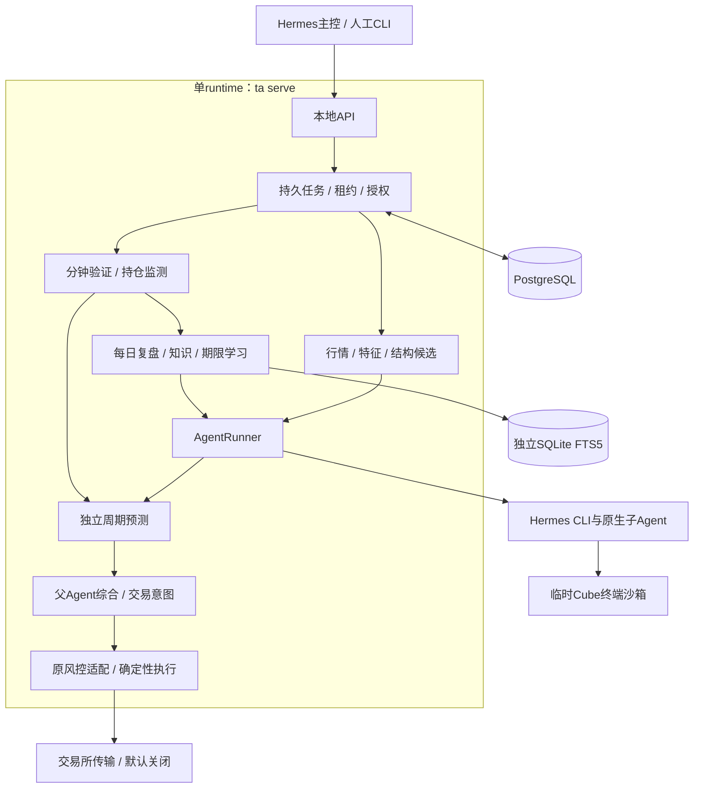

> 公开脱敏副本：安装路径、内部标识、个人链接及账户/原始业务记录已替换或隐去。历史状态和验证结果仅代表原文记录时点，不构成本仓库当前部署或收益验收。

# 交易 Agent v1：实施设计

> 2026-10-11 同步版。保留原文件名，正文描述当前已实现的预测驱动交易系统。需求以[Goal规格](../../../docs/prediction-driven-trading-goal.md)为准，字段、算法和恢复细节见[技术细节](交易Agent-v1-技术细节.md)。
> 本地代码验证：旧框架前次207项、新框架本次244项测试通过；真实模型、真实Cube隔离和线上订单尚未验收。执行默认关闭，没有部署或调用真实订单。2026-10-11补齐复盘80×4=320根输入并同步本文。
> [同步前完整规格快照](../../../archive/legacy-research/docs/prior-specifications/specifications-before-prediction-sync-2026-10-11/README.md)保留原文；旧小时分类预测、结算和策略研究记录继续按原口径解释，不能当作当前预测契约。

## 0. 先读这一页

系统用BTC、ETH的市场结构预测驱动交易。1h是父Agent的观察和交易尺度；每份预测覆盖多根K线，给出方向情景、可能到达的价格区间、触发和失效条件，以及有上限的期限。

完整流程：**行情与结构计算 → 各周期独立预测 → 父Agent综合决策 → 原风控与执行 → 事件验证 → 预测复盘与知识更新。**

| 项目 | 当前实现 |
|---|---|
| 币种与合约 | BTCUSDT/BTC-USDT-SWAP；ETHUSDT/ETH-USDT-SWAP |
| 周期 | 两币种分别维护1h、4h、6h、12h预测；另有各自1h尺度父综合 |
| 数据 | 每币种：预测30根/周期、四周期120根；复盘80根/周期、四周期320根；后台计算80根/周期，分钟数据用于事件验证 |
| 结构 | 上升三角、W底、箱体、收敛三角，包含阶段、确认关键点和水平/倾斜边界；支持多个候选及UNKNOWN |
| 子Agent | 分析指定周期的结构、情景、概率、目标与失效；独立验证和更新 |
| 父Agent | 综合所有仍有效子预测，自主决定开多、开空、观望或平仓；给出独立综合预测 |
| 风控与执行 | 确定性程序复用旧交易框架的仓位、杠杆、损失预算、止损止盈及账户限制 |
| 更新频率 | 程序每分钟验证；模型在达标、失效、到期或结构阶段变化时更新相关周期 |
| 初始期限 | 4根所属周期K线：子周期初始4/16/24/48小时，父综合初始4小时；均是初始参数 |
| 经验库 | 知识点summary、关联案例content、操作procedure；按结构及阶段召回 |
| 学习 | 每日预测复盘更新知识；程序回放、影子验证和回滚期限规则 |
| 存储 | PostgreSQL正式事实、版本和审计；独立SQLite/FTS5可重建检索索引 |
| 运行 | 单runtime、单Uvicorn worker；沿用租约、fence、权限及Hermes原生能力 |
| 接口 | 新研究API `/v2`，报告schema_version=3；旧历史API保留 |

“预测正确”“是否值得交易”“实际成交收益”分别记录。结构名字不会自动产生订单；预测目标不会直接替换订单止盈。

## 1. 范围与职责

### 1.1 预测Agent与父Agent

子Agent读取本任务冻结行情、量化特征、结构候选和知识，选择、解释候选并输出可执行情景。父Agent解释周期之间的延续、回调、冲突或未知，复用有效旧预测，不等待四周期全部重新分析。

父Agent自主判断是否入场；程序没有新增固定概率门槛，也不要求旧技术策略先给同方向信号。完全没有有效子预测、证据过期或风控不通过时，程序会拒绝开仓。

### 1.2 确定性程序与执行模块

程序负责行情质量、结构几何、输入冻结、预测校验、验证评分、知识版本、期限实验和任务恢复。执行模块只接受已登记的交易意图，经现有风控后提交订单并处理成交和异常。

模型只能发布意图，拿不到交易所执行凭据，不能自行指定仓位/杠杆、提高风险上限、改写历史预测或直接解除风控暂停。

### 1.3 预测复盘与退役范围

保留预测复盘Agent：可以提交知识新增、修订、合并、退役建议。程序检查权限、证据和版本后生效。学习体现为知识及期限规则更新，不是自动训练模型权重。

策略源码迭代Agent、对应写代码工具、旧策略经验索引的活跃入口已退役。历史源码、成交证据和迭代记录保留；原始记录不会被伪装成结构预测成功案例。

## 2. 运行结构与部署边界



所有业务模块在同一进程直接调用。API只供受信任插件和CLI使用，监听 `127.0.0.1:8765`。不新增独立交易服务、Redis、Celery、向量数据库或网页界面。

通过仓库内Python包复用旧交易框架：`ai-trading-system`保存既有风控/会计/退出，`trading-quant`保存共享量化和结构，`trading-agent`负责预测及runtime。

启动检查迁移、部署锁和凭据，取得PG单实例锁，装配模块并恢复任务，再启动后台循环。停止时先取消就绪和领取，最多等待20秒，再终止所属模型进程、撤销令牌、清理资源并释放连接。失去实例锁时停止执行，不在归属不确定时继续提交。

真实Cube环境及生产权限仍是上线验收项。同账户禁止旧交易CLI与新runtime并行执行；首次账户接入或engine切换存在仓位/未决订单时，拒绝自动切换。

## 3. Hermes接入与任务边界

不修改Hermes核心。固定参考提交为 `<private-artifact-hash>`，使用原生插件、CLI、delegate_task、Profile、终端provider及消息通道。

| 插件 | 当前职责 |
|---|---|
| `trading-bridge` | 主控查询新预测、意图及旧历史；不执行订单 |
| `trading-research` | 当前任务上下文、指定周期委派、预测/决策提交、知识搜索/展开及复盘 |
| `trading-cube` | 临时终端环境、文件桥接、命令执行与清理 |
| 可选 `trading-compat` | 保留历史成交/源码读取；旧iterate及memory-search/read工具已移除 |

`AgentRunner`以argv、`shell=False`启动隔离trading Profile的单次CLI会话。一个runtime最多一个模型顶层任务；独立周期任务只委派本次指定周期的原生子Agent，父综合不重新委派全部周期。子Agent不能再次委派、提交父决策或修改知识。

输入目录包括冻结context、角色提示词和预测/决策/复盘JSON Schema。模型终端通过Cube进入只读input与可写scratch，不能回退到宿主local。父子共用本attempt沙箱，不把按周期分目录误称为安全隔离。

结构预测和结构复盘沙箱均禁止出站，仅使用冻结输入及授权领域工具。历史EXPLAIN/REVIEW_DAILY的研究网络策略属于兼容路径，不能套用到新PREDICT_REVIEW。

沿用首轮90秒、总预算120秒及任务截止检查；成功以PG正式结果为准，退出码0或模型口头声称成功不算提交。旧FORECAST的“只修复父提交并保留1h概率”机制不适用于新父综合。

## 4. 时间、结构和预测契约

### 4.1 时间与独立更新

存储和运算使用UTC，展示按Asia/Shanghai。各周期取本周期最近已收盘边界，不把6h/12h正常边界差异误判为过期。正式输入只引用冻结时已可用的行情revision和观测。

预测截止为 `published_at + horizon_bars × 周期长度`，验证从发布后的首个完整分钟开始，只使用原截止前完整分钟。初始4根期限可以通过程序学习调整，旧报告的截止时间不改变。

原“每整点T+1取数、T+4发布、T+5开始下一小时分类”的口径只用于旧预测历史及legacy模式。结构模式使用每份预测自己的生命周期。

### 4.2 结构候选与条件

共享量化包对80根历史确认局部高低点，左右各2根已收盘K线；最近60根拟合结构，使用Wilder ATR14和默认0.25ATR容差。算法输出候选、阶段、关键点、测量高度及边界。

Agent引用候选ID进行选择和解释。程序验证类型、阶段、关键点、边界、斜率及容差一致；证据不足用UNKNOWN及冻结的回退水平，不允许编造已确认形态。

触发/失效用CLOSE_ABOVE、CLOSE_BELOW、TOUCH、SUPPORT、RESISTANCE等条件表达；可要求连续1～5根分钟K线确认。“附近支撑有效”必须落实为已冻结容差和可计算行为。

### 4.3 概率、目标与父决策

| 输出 | 精确定义 |
|---|---|
| p_up / p_down / p_none | 原期限内首先确认上行、首先确认下行、均未确认，三项和为1 |
| target_probability | 对应情景触发后，在原截止前、失效前触达目标区间的条件概率 |
| target.low/high | 上/下行情景的价格空间；不等同于下一根K线收盘价 |
| primary_direction | 主情景，用于预测生命周期及持仓结构风险；可为空 |
| 父action | OPEN_LONG、OPEN_SHORT、HOLD、CLOSE |
| trade_style | TREND、RANGE、BREAKOUT；用于选择原风险参数计算 |
| context_revision / child_prediction_ids | 冻结上下文及全部有效子预测引用，发布前再次核验 |

模型概率先标为估计，复盘时展示程序算出的历史命中和Brier评分。父Agent不能用机械平均代替解释，也不再被要求原样提交1h子概率。

## 5. 行情、特征和证据

每个周期保存80根计算历史及其revision，向预测模型提供最近30根原始K线、计算特征、结构候选及全部授权证据ID。对每个币种，四周期计算历史合计320根，四个子Agent原始视图合计120根；30根是80根的末尾子集，不额外采集。独立更新只重新取本周期需要的输入。2026-10-31用户修订：父综合有效子报告及其证据关系，不另收自身1h行情。各子模型原始视图为30根已收盘＋1根当前快照，临时指标用80+1计算；父需要时仅回读所引用子报告的原冻结证据。旧“父自身1h的30根及有效子报告”保留为后续可选开发方向，见[TODO](../../../docs/TODO.md)。

每日复盘另冻结同币种1h/4h/6h/12h各80根最近已收盘K线，共320根，连同原预测案例和程序评分交给复盘Agent。复盘窗口取任务采集开始时的UTC整点为锚点，各周期对齐自己的最近收盘边界；冻结时间单独保存。它属于复盘时的行情背景，不替代较早案例的事前证据或完整分钟验证。任一周期缺根、断档、混币种或含未来数据，均不冻结不完整输入；冻结后重试复用原窗口。

基础指标继续由共享量化包计算：收益、ADX/DI、回归趋势、RSI、ATR、布林宽度、成交量与价格位置等。CVD、OI、资金费、多空比、公开爆仓采样及市场背景按观测来源和覆盖情况计算；缺少必要数据时保留质量标记，不能用0或假数据填充。细则见[技术细节](交易Agent-v1-技术细节.md)。

分钟行情按持久游标从最老缺口补齐，每页300根、每次最多3页；只越过连续已收盘数据。行情缺口、父/子验证尚未跟上当前分钟或执行报价过期，会阻止依赖该状态的新开仓。已有预测的历史观察和持仓保护继续等待补齐。

## 6. 知识点—案例—操作指引

### 6.1 组织方式

| 层次 | 内容 | 使用方式 |
|---|---|---|
| summary | 知识点、币种/周期/结构/阶段、适用条件、局限、证据状态 | 识别问题后先查相关知识点 |
| content | 知识正文、关联预测原件、当时输入、验证过程与成功/失败/未决案例 | 按需展开支持证据和反例 |
| procedure | 预测或复盘时按顺序检查的步骤 | 指导本次分析和核验 |

案例与知识点多对多；关系包括支持、反例、未决和纠错。初始4份操作指引均为UNVERIFIED，没有虚构历史成功样本。

### 6.2 检索、冻结和更新

父子Agent均可在本任务授权范围搜索，默认最多返回5个知识点；先看summary，再分页展开content/procedure。按币种、周期、结构和阶段过滤，中文双字分词、英文/数字按词检索。

PG保存正式版本和审计，SQLite/FTS5为派生索引。搜索先确定冻结时点的最新知识版本，再排除退役项并筛选；结果与降级情况写入不可变recall。后续修订不改变旧预测看过的知识。

只有每日预测复盘可以提交NEW、REVISE、MERGE、RETIRE。程序在任务事务中检查证据和版本父链、追加PG版本，再排可重试索引任务。索引暂不可用则对PG同版本有限摘要检索；重建不需要重跑模型。

原“策略改动记录→摘要索引→候选代码修改”入口已退役，不再作为这套知识库的自动来源。

## 7. 数据库与版本

新增0009迁移，不覆盖旧forecasts/settlements，也不将历史小时标签改写为结构事件标签。

| 类别 | 表/内容 |
|---|---|
| 预测事实 | prediction_inputs、prediction_facts、prediction_evaluations、prediction_decisions |
| 执行事实 | trade_intents、execution_events |
| 知识事实 | knowledge_versions、knowledge_case_links、knowledge_recalls |
| 学习事实 | horizon_rules、horizon_trials、horizon_comparisons |
| 当前状态投影 | prediction_heads/states/streams、trade_intent_states、trading_positions/accounts、horizon_heads/trial_states |
| 原有基础 | jobs、job_attempts、runtime控制/所有权、审计、outbox及旧历史表继续保留 |

正式事实只追加，数据库触发器禁止UPDATE/DELETE/TRUNCATE；当前状态投影允许在受控事务中更新。所有任务写入在同一事务验证授权、lease、fence和截止，外部HTTP、模型、交易所及SQLite操作不占用PG业务事务。

engine包含模型/提示词/预测参数和证据契约；部署锁与runtime共用hash算法。索引位置、执行开关、账户名及旧配置目录不改变预测含义，不进入预测engine标识。

## 8. API、工具与CLI

### 8.1 新研究API

| 方法与路径 | 用途 |
|---|---|
| GET `/v2/research/context` | 当前任务冻结上下文或复盘上下文 |
| POST `/v2/research/prediction` | 发布当前周期预测 |
| POST `/v2/research/decision` | 发布父综合及意图 |
| POST `/v2/research/knowledge/search` | 授权范围知识摘要检索 |
| GET `/v2/research/knowledge/content` | 展开本任务已召回知识版本 |
| POST `/v2/research/review` | 预测复盘及知识变更建议 |
| POST `/v2/research/usage` | 模型使用记录 |

控制查询为GET `/v2/predictions/latest`、`/v2/predictions/{id}`、`/v2/intents/{id}`。没有向模型开放的订单执行API。controller只能查询/请求允许的任务；operator保留暂停/恢复等权限；research权限绑定具体attempt。

### 8.2 原生工具与CLI

研究插件保留research_context、timeframes_analyze等入口，新增decision_submit、knowledge_search、knowledge_expand；实际动作由任务类型及父子角色限制。主控新增trading_prediction_latest/get、trading_intent_get，旧历史工具继续可用。

```bash
ta --config config.yaml --json prediction latest --symbol BTCUSDT
ta --config config.yaml --json prediction latest --symbol ETHUSDT --timeframe 12h --child
ta --config config.yaml --json prediction show <prediction-uuid>
ta --config config.yaml --json intent show <intent-uuid>
```

旧策略iterate、memory-search、memory-read的CLI/插件活跃入口已移除。SQLite维护重建是 `KnowledgeService.rebuild()`，不是模型工具。

## 9. 预测验证与交易执行

### 9.1 预测评分

方向、目标、边界行为及耗时分别保存。先失效后达标仍记失效；同分钟同时触及目标和失效、顺序不可知时记AMBIGUOUS。收盘触发不能使用同一分钟更早的最高/最低价声称触发后达标。

未触发、已触发到期未决、无法判定和数据不足保留在结果/质量字段中。已结束预测停止参与当前决策，原概率观察窗口仍继续采集；程序给出分桶命中率、Brier和不可评分数量，不删除失败样本来提高成绩。

### 9.2 原交易规则接入

从旧策略抽取共用风险参数，TREND保留ATR止损和收益风险倍率，BREAKOUT保留既有突破仓位/倍率，RANGE保留区间边界止损与中点止盈。父意图直接进入原RiskEngine，绕过旧方向信号和Advisor方向裁决；仍保留原社媒风险阻断/减仓、动态杠杆、仓位、损失预算、移动退出与账户限制。

RANGE必须引用已核验箱体，当前价格到中点有正向收益空间。预测目标独立保存，不能让模型覆盖订单止盈算法。

| 情况 | 持仓行为 |
|---|---|
| 父综合失效 | 生成绑定当前持仓身份及版本的平仓意图 |
| 父综合转向 | 先平仓；后续新决策才可反手 |
| 预测仅到期 | 继续持仓，原退出规则和原结构风险监测继续 |
| 新同向综合 | 可接管结构监测，不自动追加同方向仓位 |
| 子周期反向 | 触发父综合，不直接平仓 |
| 没有持仓 | 不生成平仓订单 |

### 9.3 订单与恢复

每个意图有稳定客户端订单ID。发送前保存PREPARED/SENDING，响应未知或重启先查询原订单，不盲目重发。累计成交转换为增量入账；费用修订同步到原持仓，整仓平完才统计一次输赢。

同账户未决订单串行处理；平仓绑定position_id/revision并使用实际剩余合约数量，旧意图不能关闭新仓位。开仓预测结束或出现绑定平仓要求时，只撤尚未成交的余量；预测到期不因此平掉已成交部分。

固定保护单随开仓请求附带；软件继续用实际成交价计算原退出规则。交易所自主退出必须有唯一可绑定历史证据。未知结果、外部调仓、非USDT费用或无法核对的数据不猜测入账。

硬风控失败写入PG持久暂停，跨币种/重启仍生效；operator的既有resume接口才能解除，恢复后仍重查实际风险。模型不能解除。

## 10. 预测期限学习

按币种、周期、结构和阶段分组；候选2/3/4/6/8/12根。程序只改变回放期限，保持原结构、触发、目标和失效条件。

1. 至少40个有效历史配对样本完成回放。
2. 再累积候选提出后发布的20个后续影子样本。
3. 达标记1、失效记−1、未决记0，扣每等待一根0.01成本；平均配对分提高至少0.02且失效率增加不超过2个百分点才生效。
4. 生效后继续与旧规则影子比较，每20个完整新样本检查；分数下降超过0.02或失效率增加超过2个百分点则追加回滚版本。

样本不足保持初始值。每组最多扫描最近200份独立周期预测；父/子1h共用相同结构阶段规则，但不重复统计父预测样本。规则变更只影响新预测。

原概率入场阈值研究及人工策略审批是旧历史兼容能力，不控制这条预测驱动交易链路，也没有新增策略代码迭代Agent。

## 11. 调度、幂等与故障恢复

| 当前任务 | 职责 |
|---|---|
| PREDICT_TIMEFRAME | 指定币种、指定周期分析 |
| PREDICT_PARENT | 综合当前有效子预测并发布决策 |
| PREDICT_VERIFY | 每分钟补行情、验证预测、检查结构与原持仓退出 |
| PREDICT_REVIEW | 每币种每日预测复盘及知识建议 |
| KNOWLEDGE_INDEX | 将已提交知识版本写入SQLite |
| HORIZON_LEARN | 小时级确定性回放、影子、生效/回滚 |
| PREDICT_EXECUTE | 意图风控、订单查询/提交及增量入账 |

scheduler每60秒、executor每2秒、notifier每5秒、recovery每15秒。确定性任务最多4个，模型顶层任务最多1个；执行/验证优先，父综合与周期分析优先于复盘。结构模式不使用旧整点前后禁止低优先级任务的时间窗。

启动补齐八个周期。周期结束或阶段变化排相关更新；连续同币种更新可合并尚未冻结的父任务。发布前检查上下文版本，过时则拒绝并排新任务。暂停分析后，分钟验证与持仓保护继续。

任务持久化，领取用行锁和SKIP LOCKED；租约60秒、15秒续租，接管增加fence。过期旧执行者不能续租复活或写入结果。已有正式预测/复盘但任务尚未标成功时，以原提交恢复，不重跑覆盖。

停机后补齐分钟事实，不补造停机期间的模型预测。SQLite写失败重试索引，订单未知只查询原ID；不能把“未查到”当作“没有发送”。

## 12. 通知与默认交互

沿用现有outbox/notifier和IM+CLI入口。明确发送失败按既有上限重试；发送超时、确认丢失或SENDING租约过期保留UNKNOWN，停止自动重投，避免已送达消息刷屏。UNKNOWN不等于已送达，可能需要人工核对，不宣称恰好一次；发送失败不回滚业务事实。预测上下文过期/变化和持仓变化引起的自动刷新保留任务事实并继续刷新，不逐次发送失败通知；旧待投递同类通知标记NOTIFICATION_SUPERSEDED，保留原事件与正文。

系统启动、系统健康及账户/执行通知发主控；主控申请的解释/复盘仍回复主控。显式配置独立预测目标后，仅父综合发布（含HOLD）发一条预测摘要，分析错误组首次/最终失败告警并去重，均经既有预测Profile发至预测TG。周期子报告、目标达成、到期、失效、歧义及分析恢复成功静默；验证、评分与再分析照常，不将预测到期视为平仓。

父结果/错误通知与对应事实在同一事务保存；事务回滚不留下虚假消息。父摘要以动作结论、首次触发概率、有效期及短依据分段，错误以原因、影响和实际重试计划分段；预测/事件编号留后台。历史消息目标和正文保持，旧待发prediction-ended/analysis-recovered标记NOTIFICATION_DISABLED，SENT/UNKNOWN不改写或重发；新的预测路由与消息一起保存，旧普通target继续使用主控，不能在恢复投递时换Bot。未配置独立目标的旧安装保留原告警行为。完整结构预测、知识和执行状态继续通过API/CLI查询，不增加逐分钟推送或日报。在线消息通道须分别验收发送与回执。

## 13. 配置、代码与部署

```yaml
prediction:
  mode: structural
  symbols: [BTCUSDT, ETHUSDT]
  timeframes: [1h, 4h, 6h, 12h]
  structure_version: confirmed_pivots_v1
  tolerance_atr: '0.25'
  initial_horizon_bars: 4
  horizon_candidates: [2, 3, 4, 6, 8, 12]
  replay_min_samples: 40
  shadow_min_samples: 20
  monitor_batch_samples: 20
  minimum_score_gain: '0.02'
  maximum_failure_increase: '0.02'
  waiting_cost_per_bar: '0.01'
  context_max_age_seconds: 180
  knowledge_index_path: .local/private-evidence
  execution_enabled: false
  legacy_config_dir: ../config
  account_key: prediction-main
```

这只是预测配置片段，完整启动仍需数据库、Hermes、Cube、部署锁及已核实的行情契约。执行开启时才加载旧app/risk/strategy/runtime配置及相应凭据；不会为缺失配置生成一套宽松默认风控。DISABLED历史意图以后也不补发。

| 代码位置（相对hermes-trade） | 负责内容 |
|---|---|
| `packages/trading-quant/src/trading_quant/structures.py` | 结构候选与阶段 |
| `trading-agent/src/trading_agent/prediction/` | 契约、发布、分钟验证、调度与期限学习 |
| `trading-agent/src/trading_agent/knowledge/` | 知识版本、案例、FTS5与复盘 |
| `trading-agent/src/trading_agent/execution/` | 旧配置加载、风险适配调用、订单与账户恢复 |
| `src/trading_system/prediction_adapter.py` | 原RiskEngine、会计和退出复用 |
| `src/trading_system/strategy/risk_parameters.py` | 新旧入口共用风险参数 |
| `trading-agent/src/trading_agent/api/prediction.py` | v2契约 |
| `trading-agent/src/trading_agent/runtime/` | 单runtime、Runner、权限/隔离与恢复 |
| `trading-agent/prompts/structural/` | 父、四周期、复盘六份提示词 |
| `trading-agent/migrations/versions/0009_prediction_knowledge.py` | 新事实及状态迁移 |

## 14. 测试与验收

已记录旧框架前次207项、新框架本次244项全量回归通过，含真实PG迁移/不可变性/权限/并发恢复测试；新增9项覆盖预测120根、复盘320根、两币种隔离及非法窗口拒绝，runtime同时核对复盘沙箱实际输入。固定Hermes原生插件使用fixture模型和订单传输。Ruff本轮通过；三份wheel、资源打包及依赖锁为前次验证证据。证据、命令和限制见[验证文档](../../../docs/prediction-driven-validation.md)。

重点覆盖结构及阶段、BTC/ETH隔离、异步复用、条件先后、缺口/到期、知识冻结与索引恢复、40/20/20期限回滚、原风险参数等价、部分成交/未知查询/持仓绑定。

真实预测质量和收益、真实Cube隔离、长期行情质量、订单/保护单及账户切换流程仍需在线验收。本次不把本地通过写成线上可盈利。

## 15. 实施交付与完整报告

功能实现和自主决定分别交付，用户不需要从代码猜测。四份说明为：[实现与使用](../../../docs/prediction-driven-implementation.md)、[技术决策](../../../docs/prediction-driven-decisions.md)、[需求对照及额外功能](../../../docs/prediction-driven-requirements.md)、[验证与限制](../../../docs/prediction-driven-validation.md)。

下次交付必须在对话中直接报告主要实现与自主增加的行为，并用文档补充完整细节；仅列链接不算完成用户要求的说明。

## 16. 自主技术决定与额外配套

以下是为落实需求新增的配置或恢复能力，不等同于用户新增了这些业务目标。详细机制在技术细节第六部分。

1. 模式开关、账户标识、旧配置目录、180秒输入及90秒执行价格新鲜度。
2. 结构版本/hash、schema3/API v2、旧历史分开保存。
3. 完整分钟观察窗、1～5分钟确认、UNKNOWN回退及多个候选。
4. 同币种锁、账户锁、代际版本、任务合并、过时任务重排与并发上限。
5. 中文双字FTS5、500条PG候选回退、6000/12000字符分页、不可变recall。
6. 4份未验证procedure、90天/200条复盘及每组200份期限学习扫描上限。
7. 每根0.01等待成本、父/子1h同组期限、无法判定配对单独保留。
8. 抽取共用风险参数、RANGE几何校验、沿用社媒风险作用。
9. 执行前重读运行/风险/策略配置，发送前拒绝已过时的准备参数。
10. 持久订单状态、稳定ID、成交/费用增量去重、未知订单占用账户。
11. 撤未成交开仓余量、保留部分平仓余仓、实际张数平仓、持仓结构独立游标。
12. 附带固定保护、实际成交价的软件退出、交易所自主退出唯一证据对账。
13. 有仓或未决订单时拒绝自动切换账户/engine，不认领外部仓位。
14. 新CLI/主控只读查询、旧策略迭代活跃工具退役。
15. PG硬风控暂停及operator恢复，整仓结束才记一次输赢。
16. 沙箱Schema白名单、部署hash一致、复盘崩溃恢复、v1/v2查询地址兼容及异常数据拒绝。
17. 测试时钟/fixture修正、独立本地PG端口、wheel资源检查和改动前hash保留。

## 17. 历史兼容与证据归属

旧forecasts、settlements、趋势缓存、小时标签、历史成交/研究模块仍可按原版本读取。结构模式不把旧策略经验索引作为新知识题库，也不沿用旧父Agent概率透传规则。

已发布预测/知识/期限/执行事实保留；数据库升级采用新增迁移，不批量改写旧事实或通过回滚删除证据。历史设计的完整原文在[同步前快照](../../../archive/legacy-research/docs/prior-specifications/specifications-before-prediction-sync-2026-10-11/README.md)。当前需求、实现证据与真实线上验收分别记录。
